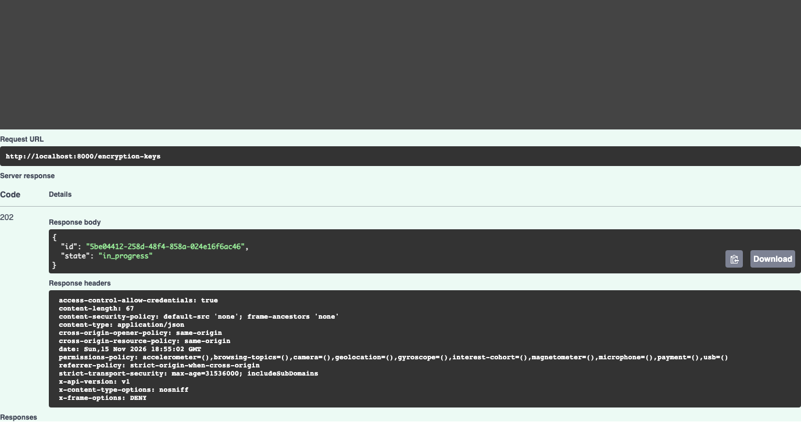
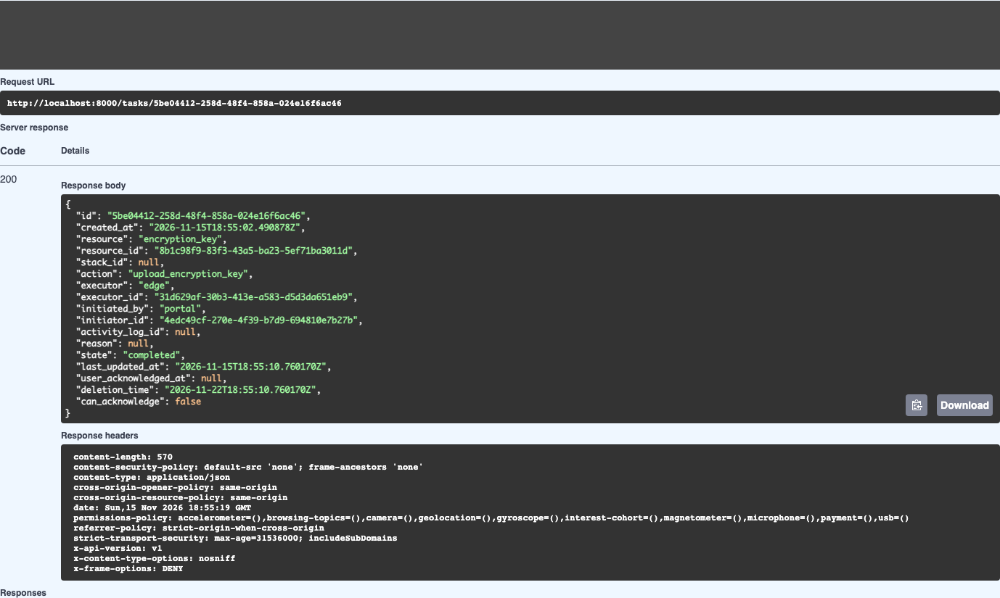
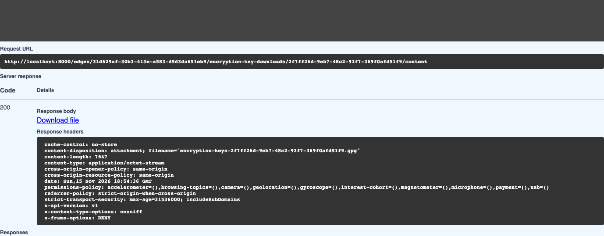
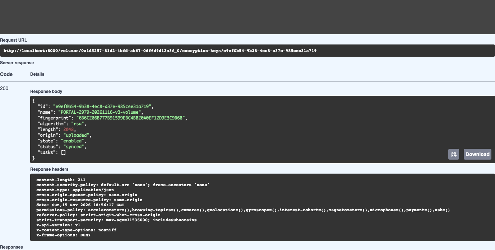
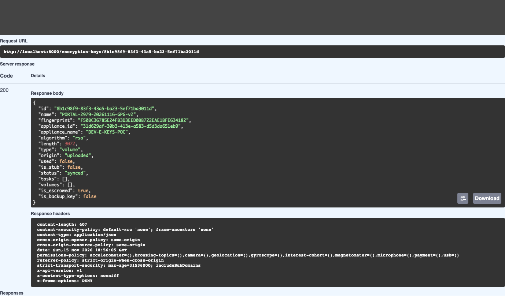
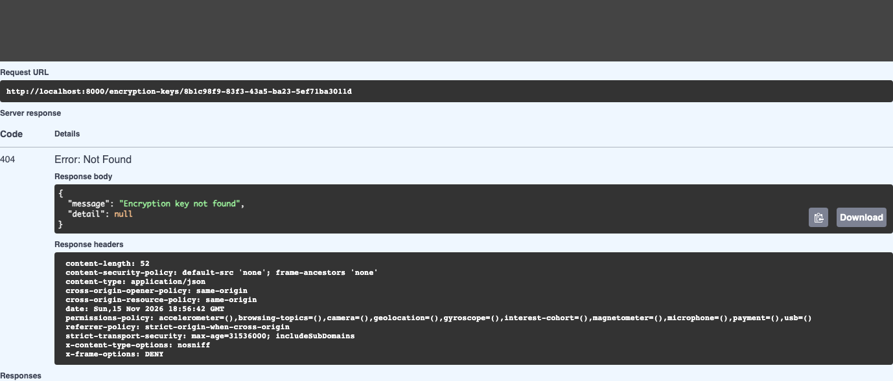

# MVI-3 encryption-key API happy-path evidence

**Result: all 16 HTTP operations passed.** Both enable and disable were exercised for the PATCH operation. Each write was followed through to a completed appliance task; resource readbacks and the final appliance comparison were checked independently.

- Test date: 16 November 2026 (Asia/Kolkata). Captures retain their original UTC timestamps.
- Application commit: `70012eea09`, draft PR [nasuni/portal#3162](https://github.com/nasuni/portal/pull/3162), based on MVI-3.
- Target: DEV-E-KEYS-POC; volume: E-Keys-Test-01.
- Requests were sent through the served Swagger UI at `http://localhost:8000/docs` using Try it out / Execute. Screenshots show the actual UI; no fabricated response panels or substituted responses.
- Successful password-protected upload and download verification use `devtools/edge-console/app/keygen.py`. This helper is local user work outside the application commit; its SHA-256 is recorded in the final verification artifact.
- 126 native Swagger PNGs, including diagnostic attempts and cleanup. [Screenshot hashes](png-sha256.json).

## Endpoint results

| Method | Path | Swagger evidence | Task proof |
| --- | --- | --- | --- |
| GET | `/encryption-keys` | [Response](01_list/01_list_response_01.png) / [JSON](01_list/result.json) | — |
| POST | `/encryption-keys` | [Response](32_upload_console_keygen/32_upload_console_keygen_response.png) / [JSON](32_upload_console_keygen/result.json) | [Completed](32_upload_console_task/result.json) |
| GET | `/encryption-keys/{key_id}` | [Response](33_get_console_key/33_get_console_key_response.png) / [JSON](33_get_console_key/result.json) | — |
| POST | `/encryption-keys/{key_id}/escrow` | [Response](37_escrow/37_escrow_response.png) / [JSON](37_escrow/result.json) | [Completed](38_escrow_task/result.json) |
| DELETE | `/encryption-keys/{key_id}` | [Response](40_delete/40_delete_response.png) / [JSON](40_delete/result.json) | [Completed](41_delete_task/result.json) |
| GET | `/edges/{edge_id}/public-key` | [Response](03_public_key/03_public_key_response.png) / [JSON](03_public_key/result.json) | — |
| GET | `/edges/{edge_id}/encryption-key-summary` | [Response](02_summary/02_summary_response.png) / [JSON](02_summary/result.json) | — |
| GET | `/edges/{edge_id}/escrow-passphrase` | [Response](36_passphrase_readback/36_passphrase_readback_response.png) / [JSON](36_passphrase_readback/result.json) | — |
| PUT | `/edges/{edge_id}/escrow-passphrase` | [Response](34_put_passphrase/34_put_passphrase_response.png) / [JSON](34_put_passphrase/result.json) | [Completed](35_passphrase_task/result.json) |
| POST | `/edges/{edge_id}/encryption-key-downloads` | [Response](15_export_console_request/15_export_console_request_response.png) / [JSON](15_export_console_request/result.json) | [Completed](19_export_console_task/result.json) |
| GET | `/edges/{edge_id}/encryption-key-downloads/{task_id}` | [Response](16_export_console_status/16_export_console_status_response.png) / [JSON](16_export_console_status/result.json) | — |
| GET | `/edges/{edge_id}/encryption-key-downloads/{task_id}/content` | [Response](17_export_console_content/17_export_console_content_response.png) / [JSON](17_export_console_content/result.json) | — |
| GET | `/volumes/{volume_id}/encryption-keys` | [Response](23_volume_list/23_volume_list_response_01.png) / [JSON](23_volume_list/result.json) | — |
| POST | `/volumes/{volume_id}/encryption-keys` | [Response](20_volume_add/20_volume_add_response.png) / [JSON](20_volume_add/result.json) | [Completed](21_volume_add_task/result.json) |
| GET | `/volumes/{volume_id}/encryption-keys/{key_id}` | [Response](29_volume_key_enabled/29_volume_key_enabled_response.png) / [JSON](29_volume_key_enabled/result.json) | — |
| PATCH | `/volumes/{volume_id}/encryption-keys/{key_id}` | [Response](24_volume_disabled/24_volume_disabled_response.png) / [JSON](24_volume_disabled/result.json); [Response](27_volume_enabled/27_volume_enabled_response.png) / [JSON](27_volume_enabled/result.json) | [Disable](25_volume_task/result.json), [Enable](28_volume_task/result.json) |

## State verification

- Upload: the GnuPG-generated, password-protected key became a non-stub resource. Escrow returned `is_escrowed=true`; deletion completed and GET returned 404. [Verification](escrow-delete-verification.json).
- Download: 7,647 encrypted bytes were saved through Swagger’s native Download file link, decrypted with the console helper, and the two contained fingerprints matched the appliance’s generated keys. The content URL was removed after retrieval. [Verification](export-console-verification.json).
- Volume: add completed; GET showed enabled. PATCH disable and enable each completed with matching GET state. A final disable left the added key inactive. [Verification](volume-flow.json).
- Escrow passphrase: PUT reapplied the existing value. The task completed and a direct appliance comparison confirmed the value was unchanged. No plaintext passphrase is included. [Verification](passphrase-verification.json).
- All pre-existing key metadata, volume associations and their enabled/disabled states remained unchanged. [Before](appliance-before.json), [after](appliance-after.json), [assertions](final-resource-verification.json).

## Test setup and cleanup

The local stack was started with `make run` in the preceding session and remained running. Authentication used a locally minted token for the existing test-account owner. The local feature cache was temporarily enabled; readiness was temporarily refreshed only after SSH liveness verification because normal local heartbeat ingestion was stale. These controls mean this run does not establish production IdP login or heartbeat freshness behavior. [Control restoration](control-restoration.json).

The original readiness timestamp and feature-cache state were restored (or a newer external update was preserved). Unused disposable keys were deleted through the API; failed fixture-upload tasks were acknowledged and their stubs removed. One newly added key remains disabled on E-Keys-Test-01 because the API exposes no unassociate operation: `e9ef0b54-9b38-4ec8-a37e-985cee31a719`, fingerprint `6B6C286B777B91599EBC4BB20A0EF12D9E3C9B68`. [Cleanup](cleanup-operations.json).

## Retained diagnostic attempts and scope

Earlier fixture attempts are retained and are not counted as completed happy paths. A primary-only test key was rejected as sign-only. A base64-inside-encryption retry failed armor decoding. A console-helper attempt incorrectly supplied an encrypted upload password; the successful retry supplied the helper’s expected password within the encrypted command transport. These failed tasks were acknowledged and their stubs removed. [Appliance error details](upload-diagnostics.json).

The initial binary capture reported zero bytes because Chromium did not expose the Swagger blob body through that capture method; the server header showed a nonempty response. The corrected capture clicked the native Download file link and verified byte length, decryption and fingerprints. The retained `12_export_content` record is not the successful artifact verification. The initial volume-list attempt supplied an unsupported limit parameter; the final request used the actual served schema.

HTTP `outcome: PASS` in an individual request record describes status and UI/network agreement only. Task and resource success are established by the linked verification records and endpoint matrix. Authorization-denial cases, concurrency, timeout/DLQ handling, backup-key upload and optional `disable_existing=true` are outside this happy-path run. The existing backup key was preserved.

## Representative screenshots

### Upload with console keygen

### Successful task completion

### Download content

### Volume key enabled

### Escrowed key

### Deleted key no longer available

