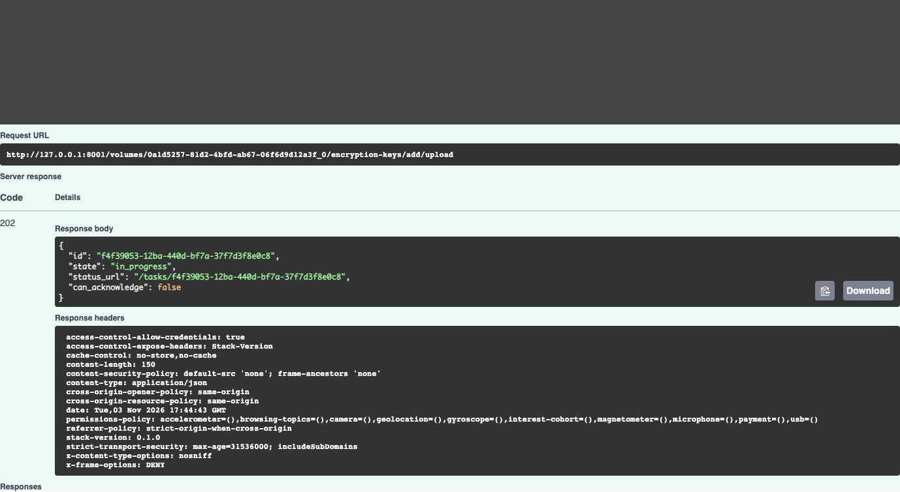
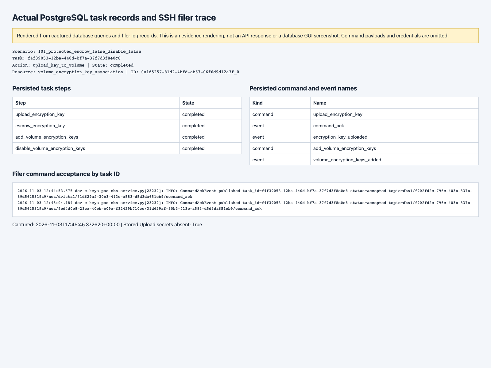
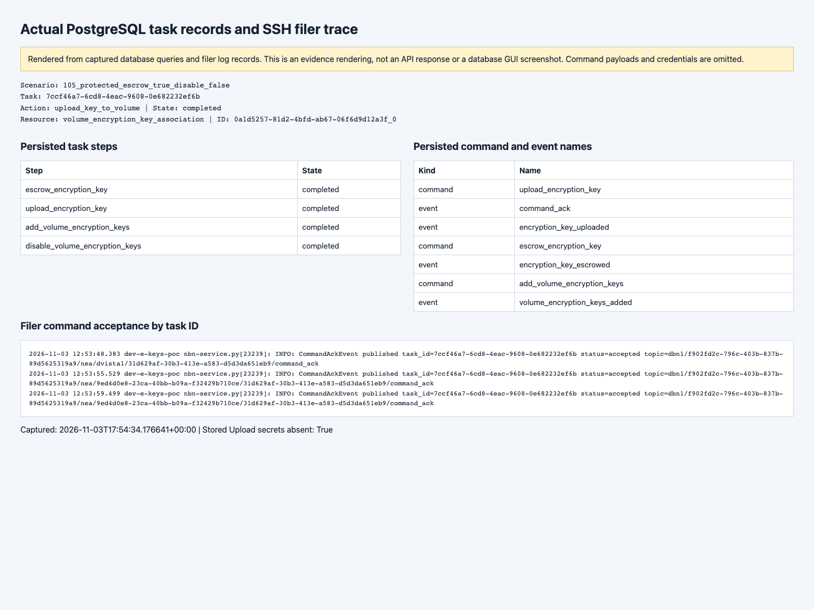
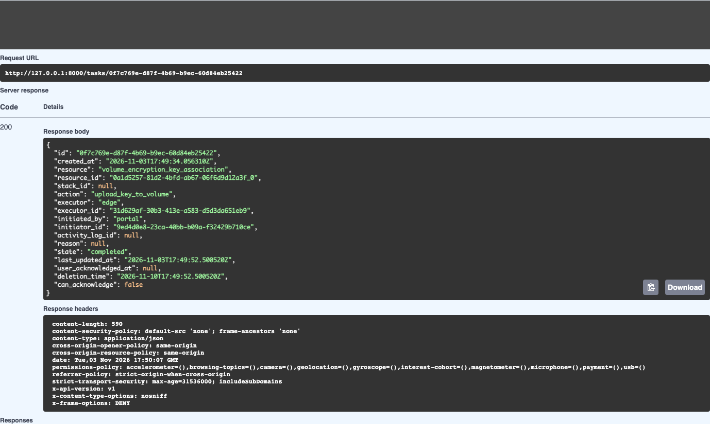
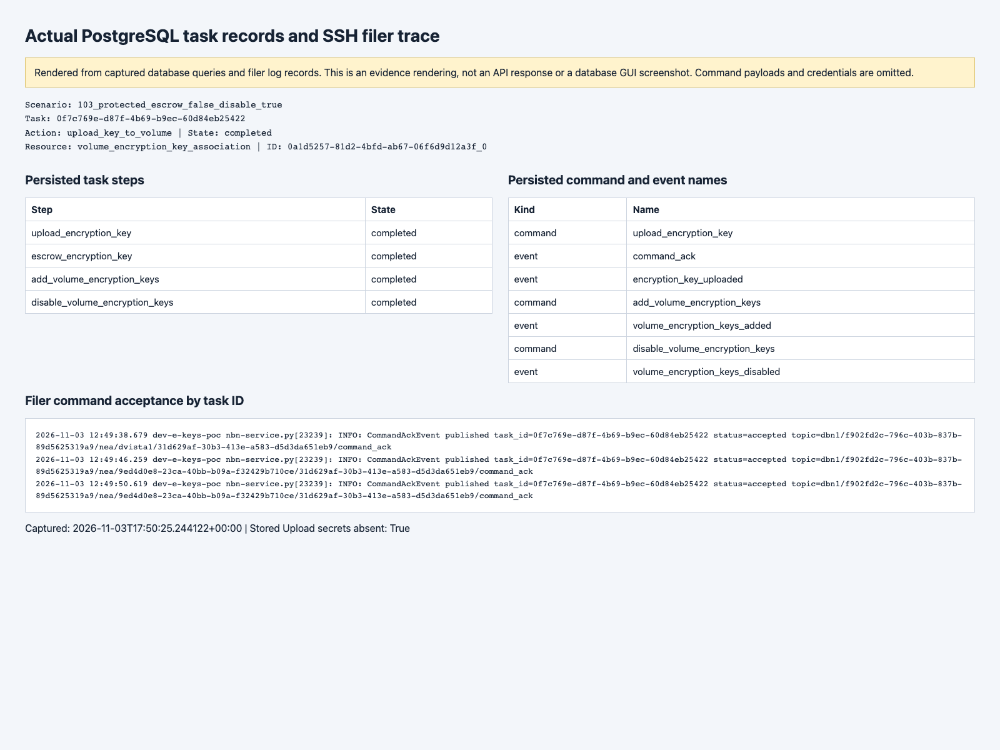
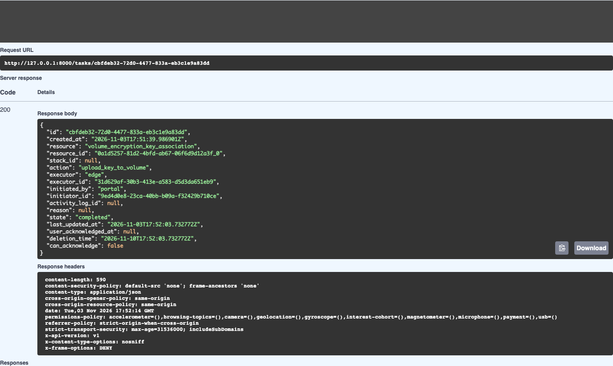
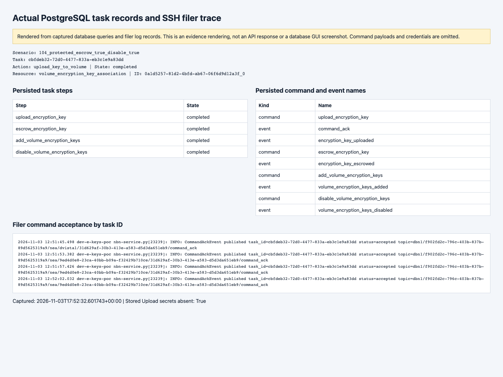

# PORTAL-3646 WebBFF upload-and-add live testing

Tested application commit: **`5483956e1b0bccc902d9061a8b0a8111c0863771`**, branch `sbhushan/PORTAL-3646_webbff_upload_and_add`. Run: `20261103-172630`. PR: https://github.com/nasuni/portal/pull/3071.

**Result:** all four Escrow/Disable combinations completed against the real appliance using passphrase-protected keys. **One earlier generated protected key failed at Upload; that attempt is retained as an unresolved appliance/key-compatibility finding.** A distinct replacement key, independently checked with GnuPG, completed the same combination. This is not an all-attempts-passed claim.

Captured **48 native Swagger requests**, each with matching network status, URL and displayed body, and **208 PNGs** (202 native Swagger screenshots and 6 clearly labeled PostgreSQL/filer evidence renderings). There were 20 requests to the upload endpoint: four completed workflows, one unexpected appliance failure, twelve authentication/permission/input rejections, two supported-version rejections, and one expected asynchronous duplicate failure. Supporting reads, acknowledgement and restoration requests are included in the 48 total.

## Completed workflow matrix

| Escrow | Disable existing | Outcome | Task | Evidence |
| --- | --- | --- | --- | --- |
| false | false | completed | `f4f39053-12ba-440d-bf7a-37f7d3f8e0c8` | [assertions](swagger/101_protected_escrow_false_disable_false/assertions.json) · [task/steps](swagger/101_protected_escrow_false_disable_false/terminal-database.json) · [command/events](swagger/101_protected_escrow_false_disable_false/command-event-ledger.json) · [filer trace](swagger/101_protected_escrow_false_disable_false/filer-log.json) |
| true | false | completed | `7ccf46a7-6cd8-4eac-9608-0e682232ef6b` | [assertions](swagger/105_protected_escrow_true_disable_false/assertions.json) · [task/steps](swagger/105_protected_escrow_true_disable_false/terminal-database.json) · [command/events](swagger/105_protected_escrow_true_disable_false/command-event-ledger.json) · [filer trace](swagger/105_protected_escrow_true_disable_false/filer-log.json) |
| false | true | completed | `0f7c769e-d87f-4b69-b9ec-60d84eb25422` | [assertions](swagger/103_protected_escrow_false_disable_true/assertions.json) · [task/steps](swagger/103_protected_escrow_false_disable_true/terminal-database.json) · [command/events](swagger/103_protected_escrow_false_disable_true/command-event-ledger.json) · [filer trace](swagger/103_protected_escrow_false_disable_true/filer-log.json) |
| true | true | completed | `cbfdeb32-72d0-4477-833a-eb3c1e9a83dd` | [assertions](swagger/104_protected_escrow_true_disable_true/assertions.json) · [task/steps](swagger/104_protected_escrow_true_disable_true/terminal-database.json) · [command/events](swagger/104_protected_escrow_true_disable_true/command-event-ledger.json) · [filer trace](swagger/104_protected_escrow_true_disable_true/filer-log.json) |

Every completed case verifies all four persisted task steps, only the requested appliance command sequence, actual confirmation events, canonical accepted-task identity/URL, the appliance UID as the authoritative key name, enabled new association, exact Disable target snapshot where selected, confirmed non-stub rows, no task duplicated onto key rows, stripped Upload secrets in persisted commands, and task-correlated filer acceptance. Escrow cases verify confirmed escrow state with the **real NOC Key Escrow license enabled** and the existing appliance escrow passphrase.

The requests used `POST /volumes/{volume_id}/encryption-keys/add/upload` on WebBFF at port 8001. Supporting individual-task terminal reads used WebAPI Swagger at port 8000; WebBFF exposes task-summary and collection task reads. `status_url` is forwarded unchanged from WebAPI. No single-task GET route was added to WebBFF during testing.

## Retained unexpected appliance failure

The first Escrow=true / Disable=false attempt received 202 and a real `command_ack` accepted event, then failed before Escrow or Add with:

> Internal error processing command: Legacy route configuration.encryption_keys.upload failed: Key cannot be used with supplied passphrase on key: PORTAL-3646-E2E-20261103-172630-2.

Task: `5ef3c6a2-0c1d-41f9-9a44-09b5d7aec11d`. [Accepted response](swagger/102_protected_escrow_true_disable_false/result.json), [terminal task](swagger/102_protected_escrow_true_disable_false_terminal_task/result.json), [actual error event](swagger/102_protected_escrow_true_disable_false/appliance-error.json), [filer trace](swagger/102_protected_escrow_true_disable_false/filer-log.json).

The root cause remains unconfirmed. No application workaround was introduced and the failed Upload was not blindly repeated. The distinct replacement fingerprint was checked locally: GnuPG imported it, rejected an intentionally wrong passphrase and exported its secret key with the expected passphrase. It then completed Upload → Escrow → Add. [Generation/validation manifest](generated-key-manifest.json). The failed fingerprint was absent from the final actual appliance dump.

## Rejections, failure placement and acknowledgement

| Native Swagger scenario | HTTP status | Evidence |
| --- | --- | --- |
| `006_actual_version_guard` | 405 | [response](swagger/006_actual_version_guard/result.json) |
| `201_unauthenticated` | 401 | [response](swagger/201_unauthenticated/result.json) |
| `202_empty_file` | 422 | [response](swagger/202_empty_file/result.json) |
| `203_oversize_file` | 413 | [response](swagger/203_oversize_file/result.json) |
| `204_exact_file_limit_reaches_pgp_validation` | 400 | [response](swagger/204_exact_file_limit_reaches_pgp_validation/result.json) |
| `205_unencrypted_file` | 400 | [response](swagger/205_unencrypted_file/result.json) |
| `206_missing_disable_choice` | 422 | [response](swagger/206_missing_disable_choice/result.json) |
| `207_invalid_fingerprint` | 422 | [response](swagger/207_invalid_fingerprint/result.json) |
| `208_invalid_escrow_choice` | 422 | [response](swagger/208_invalid_escrow_choice/result.json) |
| `209_missing_file` | 422 | [response](swagger/209_missing_file/result.json) |
| `210_missing_escrow_permission` | 403 | [response](swagger/210_missing_escrow_permission/result.json) |
| `211_no-manage_permission` | 403 | [response](swagger/211_no-manage_permission/result.json) |
| `212_no-disable_permission` | 403 | [response](swagger/212_no-disable_permission/result.json) |
| `500_restored_version_guard` | 405 | [response](swagger/500_restored_version_guard/result.json) |

The exact 5 MiB file reached OpenPGP validation and returned 400; 5 MiB + 1 byte returned 413. Empty files returned the documented domain-error 422 (`detail: null`), while malformed fields returned validation-error 422 (`detail` list). The served OpenAPI union and five real 422 responses were independently validated. [422 schema verification](422-response-schema-verification.json).

Malformed required values that Swagger blocks locally were supplied through its documented request interceptor after filling valid UI placeholders; those captures explicitly say so. Responses were never intercepted or replaced. Permission fixtures exist only in the isolated local database. [Permission fixtures](permission-fixtures.json).

An already uploaded fingerprint received 202 and then the real appliance error “already present.” Its failed task appeared on the volume parent, was absent from individual key tasks and DR Readiness, and left key states unchanged. POST acknowledgement returned 204, hid the failure from active reads and retained the task's failed state. [Assertions](swagger/301_duplicate_fingerprint/assertions.json), [actual duplicate error](swagger/301_duplicate_fingerprint/appliance-error.json), [failed volume projection](swagger/303_duplicate_volume_failure/result.json), [DR projection](swagger/304_duplicate_dr_readiness/result.json), [acknowledged record](swagger/301_duplicate_fingerprint/acknowledgement-database.json).

## Environment and explicit test controls

- Account: `f902fd2c-796c-403b-837b-89d5625319a9`; NOC account name `sbhushan1`.
- Appliance: `31d629af-30b3-413e-a583-d5d3da651eb9` / `DEV-E-KEYS-POC`; volume `0a1d5257-81d2-4bfd-ab67-06f6d9d12a3f_0` / `E-Keys-Test-01`.
- Started containers with `make run`. Refreshed expired AWS SSO/CodeArtifact credentials. Existing DB/Redis containers had lost their Docker network attachment; they were reconnected without removing their data. Runtime AWS SDKs were directed to the refreshed `portal-dev` profile through a temporary Compose override.
- The original local database had 37 missing model columns despite its migration ledger. It was preserved. A separate database, `portal3646_e2e_20261103_172630`, was migrated normally, and the existing account, users, roles and permission rows were copied into it. [Schema preflight](schema-preflight.json), [identity fixture counts/migration head](identity-fixtures.json).
- A NOC-derived appliance identity stub was followed by a **real FullDumpCommand/FullDumpEvent** to populate appliance, volume and key projections. A read-only full dump was reissued after response-queue setup; no uncertain Upload was retried. Fresh account-filtered FIFO/non-FIFO queues feed the actual Docker EventHub processor. No mocked command acceptance or synthetic completion events were used. [Bootstrap](bootstrap-full-dump.json), [read reissue](bootstrap-read-reissued.json), [queue metadata](response-queues.json).
- NOC inventory reports 10.6, but the actual appliance Full Dump reports **10.5**. The unmodified endpoint returned 405. The previously authorized temporary **10.6 → 10.5 local minimum** was used for the workflow test, then restored and rechecked with another native 405. These results do not establish compatibility with an actual 10.6 appliance. [Version evidence](actual-appliance-version.json), [temporary overrides](temporary-overrides.json), [restored gate](swagger/500_restored_version_guard/result.json).
- Temporarily enabled the account encryption-key feature in **local Redis**, then restored its prior cache state. The real escrow license and appliance escrow passphrase were used; neither was replaced or mocked. Readiness timestamps in the isolated database were refreshed after successful SSH liveness checks; ordinary heartbeat ingestion is outside this run's coverage. [Feature control](feature-flag-test-control.json), [readiness controls](readiness-controls.jsonl), [control restoration](control-restoration.json).
- Native WebBFF Swagger used its normal `access_token` cookie. Locally signed tokens identified existing persisted fixture users; roles were resolved by WebAPI. External IdP login and refresh-token issuance were not tested. Tokens and unlock passphrases remained in private process/browser/runtime storage and are excluded from publication; curl/auth UI is masked.
- Generated input used the supplied `devtools/edge-console/app/keygen.py`, whose hash is recorded in the manifest. That file and other pre-existing edge-console edits were not changed by this testing work.
- **No `include_in_schema=True` or Swagger source change was needed.** WebBFF already exposes this route in its development schema. Shared middleware/parser changes were not added.

## Restoration, remaining state and limits

Seven real Enable/Disable tasks restored **every original association state**, then disabled the four confirmed test associations. A final real FullDumpEvent independently confirmed those original states, four reported generated keys, absence of the rejected fingerprint, and that the original escrow passphrase remains configured. No keys, associations, volumes or original database data were deleted. [Restoration](baseline-restoration.json), [final actual-appliance readback](final-appliance-readback.json).

The isolated database, local identity fixtures, disabled test keys and account-filtered queues remain available for inspection, and the user-requested containers remain running. Runtime configuration lives in the private local evidence directory; it is not a product-code change. Normal source version gates and the original feature-cache state were restored. [Final verification](final-verification.json).

After restoring source controls, focused WebBFF upload tests passed **43 tests, with one existing expected failure**. The expected failure records acceptance of a truncated trailing optional multipart field by the installed parser; malformed truncation was not sent to the real appliance. The broader automated runs already recorded in the PR remain separate from this live run. [JUnit](automated/upload-routes-junit.xml), [test log](automated/upload-routes.log).

Harness corrections are retained and do not count as successful retries: a legacy-volume-ID SQL assertion, a historical escrow command name and unsupported Chromium multipart telemetry were corrected without repeating their Uploads or altering application responses. [Correction ledger](harness-corrections.json).

## Screenshots

These are original native Swagger captures. PostgreSQL/filer figures are separate, explicitly labeled renderings of actual saved records. [PNG hashes](png-sha256.json), [request index](scenario-index.json), [local HTML gallery](index.html).

Escrow=false, Disable=false — completed

Escrow=true, Disable=false — completed

Escrow=false, Disable=true — completed

Escrow=true, Disable=true — completed

