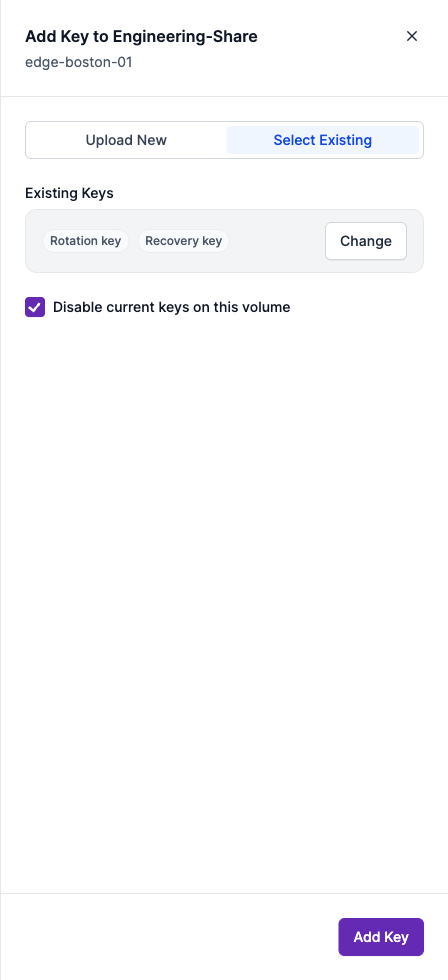
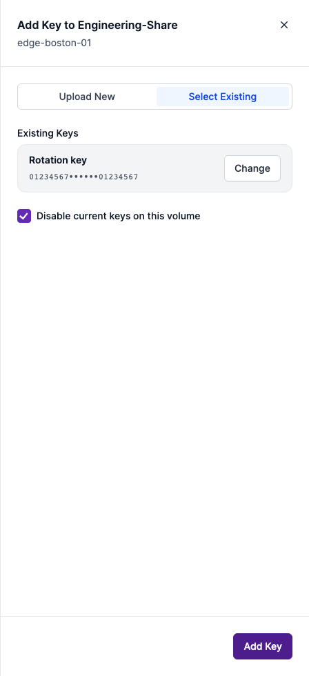

# PORTAL-3687 — Encryption Keys frontend fixes

[Ticket](https://nasuni.atlassian.net/browse/PORTAL-3687) · Source: `sbhushan/PORTAL-3687_frontend_fixes`, commit `36d2fe21f0`, rebased onto remote MVI-4 `1deb991baf`.

Captured on 6 November 2026 from the running Portal development app in Chromium at 1440 × 980, using actual route components, both production stylesheets, synthetic MSW scenarios, and an isolated mock user. External telemetry and vendor traffic were blocked. Add Key drawers measure 448 × 980; page captures measure 1440 × 980.

The before image is the earlier actual drawer capture from the same day, before the selected-key summary change. It is included with its original provenance rather than described as a fresh capture of the rebased base. After images come from the final rebased source commit above.

| Scenario | Evidence |
| --- | --- |
| Before: multiple selected keys rendered as individual gray pills | [Before drawer](2026-11-06-36d2fe21f0/00-before-existing-key-pills.png) |
| Version requirement pill and static, right-aligned DR warning dot | [Header and navigation](2026-11-06-36d2fe21f0/01-volume-keys-header-warning-dot.png) |
| Existing-key choices pending: Select disabled without “Loading keys…” text | [Loading without text](2026-11-06-36d2fe21f0/03-existing-keys-loading-no-text.png) |
| One selected key: name and compact fingerprint, with Change | [Single selection](2026-11-06-36d2fe21f0/04-existing-single-key-summary.png) |
| More than one selected key: count only, with Change | [Multiple selection](2026-11-06-36d2fe21f0/05-existing-multiple-key-count.png) |
| Export accepted and still preparing: centered spinner, unchanged 38 × 38 button footprint | [Export pending](2026-11-06-36d2fe21f0/06-export-pending-spinner.png) |
| Account-wide banner and unfiltered appliance rows | [Before applying filter](2026-11-06-36d2fe21f0/07-dr-readiness-before-filter.png) |
| Banner warning filter applied, request deliberately held pending: banner and previous rows remain | [Filter pending](2026-11-06-36d2fe21f0/08-dr-readiness-filter-pending.png) |
| Filter response received: matching rows replace previous rows while the banner remains | [Filtered results](2026-11-06-36d2fe21f0/09-dr-readiness-filtered.png) |

## Before and after

| Before | After: one key | After: multiple keys |
| --- | --- | --- |
|  |  |  |

## Capture checks and limits

The capture script verified the Add Key drawer width, the export button's unchanged dimensions before and during pending state, the spinner after export acceptance, and that Finance Edge remained visible during a held passphrase filter request and disappeared after its response. The page's account-wide readiness banner stayed visible throughout. The pending snapshots used controlled responses rather than relying on a brief timing window.

These screenshots show frontend behavior with synthetic data. They do not establish live appliance execution or backend export correctness. Automated page-flow validation is recorded in the Portal PR. [Manifest](2026-11-06-36d2fe21f0/manifest.json) records scenario descriptions, dimensions, source identifiers, and SHA-256 hashes. No screenshots were added to the Portal code repository.
