# PORTAL-3762 live appliance testing

> **Correction after the protected-key retest:** the separately encrypted upload unlock-passphrase requirement was incorrect. The existing appliance endpoint forwards plaintext `SecretStr`. Removing the extra Portal validation made all four protected-key combinations pass. See the [passing protected-key retest](../20261101-143256/README.md). The results below remain the historical pre-fix run.

Tested application commit: `69559978ecf3e7da43e1b318126223fbae03448f`.

**Result:** all four workflow combinations completed against the real filer using encrypted key files with an empty unlock passphrase. A separate passphrase-protected key case failed on the selected 10.5 appliance; that compatibility gap remains unresolved.

Captured 35 native Swagger requests with network/UI equivalence checks and 115 screenshots.

| Escrow | Disable existing | Result | Task | Evidence |
| --- | --- | --- | --- | --- |
| false | false | Completed | `064875d5-5d9a-4ac3-b821-5d92cf37d34b` | [Assertions](swagger/007_retry_upload_escrow_false_disable_false/assertions.json), [task/steps](swagger/007_retry_upload_escrow_false_disable_false/terminal-database.json), [command/event ledger](swagger/007_retry_upload_escrow_false_disable_false/command-event-ledger.json) |
| true | false | Completed | `7e08c891-6f69-47cf-b765-282cf352c6f8` | [Assertions](swagger/008_retry_upload_escrow_true_disable_false/assertions.json), [task/steps](swagger/008_retry_upload_escrow_true_disable_false/terminal-database.json), [command/event ledger](swagger/008_retry_upload_escrow_true_disable_false/command-event-ledger.json) |
| false | true | Completed | `bcb4d21e-9247-4881-9686-832a707c26b5` | [Assertions](swagger/009_retry_upload_escrow_false_disable_true/assertions.json), [task/steps](swagger/009_retry_upload_escrow_false_disable_true/terminal-database.json), [command/event ledger](swagger/009_retry_upload_escrow_false_disable_true/command-event-ledger.json) |
| true | true | Completed | `70ce4743-0f88-4f1f-8b2c-896612f4e1f2` | [Assertions](swagger/010_retry_upload_escrow_true_disable_true/assertions.json), [task/steps](swagger/010_retry_upload_escrow_true_disable_true/terminal-database.json), [command/event ledger](swagger/010_retry_upload_escrow_true_disable_true/command-event-ledger.json) |

The persisted command/event ledgers verify exactly the requested commands, real appliance confirmations, and omission of upload secrets from stored commands. Optional steps settle without commands. The real key name comes from its OpenPGP UID despite a different request name hint. No key/association stubs are created. Composite tasks are volume-owned and absent from individual key/association task collections.

## Environment and temporary testing controls

- Account: `f902fd2c-796c-403b-837b-89d5625319a9`; filer serial: `31d629af-30b3-413e-a583-d5d3da651eb9`; volume: `0a1d5257-81d2-4bfd-ab67-06f6d9d12a3f_0`.
- Started the local stack with `make run`; AWS SSO/CodeArtifact authentication was refreshed after the first build failed.
- **`include_in_schema=True` was added only for local Swagger testing, then restored to `False`.** The upload endpoint is hidden in the final served OpenAPI schema.
- The selected filer reports 10.5. The user explicitly authorized a temporary local minimum-version override from 10.6 to 10.5; it was restored afterward. These results do not establish compatibility with an actual 10.6 appliance.
- Temporarily enabled the account encryption-key feature in the local cache and restored its prior disabled state afterward. The real NOC Key Escrow license was enabled and was not mocked; the existing user permissions and escrow passphrase were used.
- Used locally signed JWTs for the existing persisted user. External browser/IdP login was not tested. Tokens stayed in process/browser memory and are masked from screenshots.
- The local filer heartbeat timestamp was stale. Successful SSH liveness observations supplied a documented local readiness control. Ordinary heartbeat ingestion was not validated.
- Restored the missing additive `volume_connections.volume_ref_id` column/backfill/constraints from existing migration `e1a7c3f9b2d6`; Alembic had recorded it despite local schema drift. No application migration source changed.
- Actual responses were handled by the Docker EventHub SQS poller. No mocked command acceptance or synthetic completion events were used.

[Environment](environment.json) · [temporary overrides/restoration](temporary-overrides.json) · [schema repair](schema-repair.json) · [control restoration](control-restoration.json) · [baseline restoration](baseline-restoration.json)

## Protected-key compatibility finding

The first passphrase-protected key was generated with GnuPG as shown by the supplied edge-console key generator, then encrypted to the filer public key. The new API contract also requires the unlock passphrase encrypted to that key. The filer accepted the command but returned:

> Key cannot be used with supplied passphrase on key: PORTAL-3762-E2E-20261101-140102-1.

The supplied edge-console generator sends that unlock password as plaintext within the encrypted command envelope. The planning document explicitly requires an individually encrypted unlock passphrase. That mismatch was not bypassed or changed in application code. The four successful cases use an empty unlock passphrase, which the endpoint supports.

[Sanitized actual filer error/ack](protected-key-filer-failure.json) · [accepted request](swagger/003_retry_upload_escrow_false_disable_false/result.json) · [failed terminal task](swagger/003_retry_upload_escrow_false_disable_false_terminal_task/result.json)

## Negative cases and harness corrections

- Missing authentication returned HTTP 401 through native Swagger.
- Re-uploading an already uploaded fingerprint returned HTTP 202 and then an asynchronous appliance failure. The failed composite task appeared only in the volume collection. Acknowledgement removed it from active task reads without changing confirmed rows.
- Shared task completion automatically acknowledges older failures for the same resource/action. The harness initially expected the older failure to remain visible; that expectation was corrected and the duplicate upload was not repeated.
- Native Swagger single-line password inputs strip armored-PGP line breaks. The first request returned HTTP 400 before creating a task. The capture driver then preserved multiline form data through Swagger’s request interceptor; responses were never intercepted or replaced. Both attempts are retained.

[Duplicate assertions](swagger/101_duplicate_fingerprint_upload/assertions.json) · [acknowledgement correction](harness-acknowledgement-correction.json)

## Final state and limits

The original six volume-key association states were restored through real Enable/Disable commands. Four confirmed test keys and their disabled associations remain available for inspection. One additional pre-existing association synchronized during the run; it was already disabled and was left unchanged. No key deletion or passphrase replacement was performed. Temporary source/configuration controls were restored; the local additive schema repair remains. Private keyrings, encrypted upload artifacts, tokens and harness programs are excluded from publication.

Filer evidence is filtered SSH output from `/var/log/nasuni/broadcast_network.log`, correlated by exact task UUID. Payload-bearing lines are omitted. Database/filer PNGs are clearly labeled renders of saved actual results; the Swagger PNGs are native browser captures.

## Screenshot and response index

### 001_baseline_volume_keys

`GET /volumes/{volume_id}/encryption-keys` — HTTP 200. [Full result](swagger/001_baseline_volume_keys/result.json)

[Screenshot: 001_baseline_volume_keys_parameters_01.png](swagger/001_baseline_volume_keys/001_baseline_volume_keys_parameters_01.png)

[Screenshot: 001_baseline_volume_keys_response_01.png](swagger/001_baseline_volume_keys/001_baseline_volume_keys_response_01.png)

[Screenshot: 001_baseline_volume_keys_response_02.png](swagger/001_baseline_volume_keys/001_baseline_volume_keys_response_02.png)

[Screenshot: 001_baseline_volume_keys_response_03.png](swagger/001_baseline_volume_keys/001_baseline_volume_keys_response_03.png)

### 002_baseline_appliance_summary

`GET /edges/{appliance_id}/encryption-keys/summary` — HTTP 200. [Full result](swagger/002_baseline_appliance_summary/result.json)

[Screenshot: 002_baseline_appliance_summary_parameters_01.png](swagger/002_baseline_appliance_summary/002_baseline_appliance_summary_parameters_01.png)

### 003_retry_upload_escrow_false_disable_false

`POST /volumes/{volume_id}/encryption-keys/upload` — HTTP 202. [Full result](swagger/003_retry_upload_escrow_false_disable_false/result.json)

[Screenshot: 003_retry_upload_escrow_false_disable_false_parameters_01.png](swagger/003_retry_upload_escrow_false_disable_false/003_retry_upload_escrow_false_disable_false_parameters_01.png)

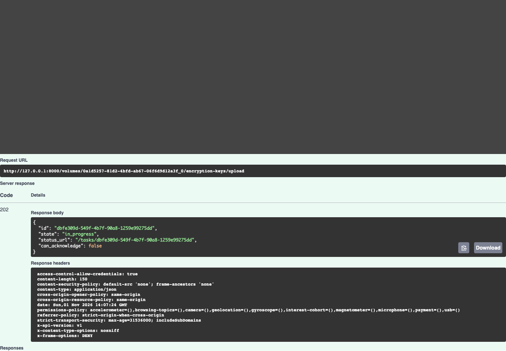

### 003_retry_upload_escrow_false_disable_false_terminal_task

`GET /tasks/{task_id}` — HTTP 200. [Full result](swagger/003_retry_upload_escrow_false_disable_false_terminal_task/result.json)

[Screenshot: 003_retry_upload_escrow_false_disable_false_terminal_task_parameters_01.png](swagger/003_retry_upload_escrow_false_disable_false_terminal_task/003_retry_upload_escrow_false_disable_false_terminal_task_parameters_01.png)

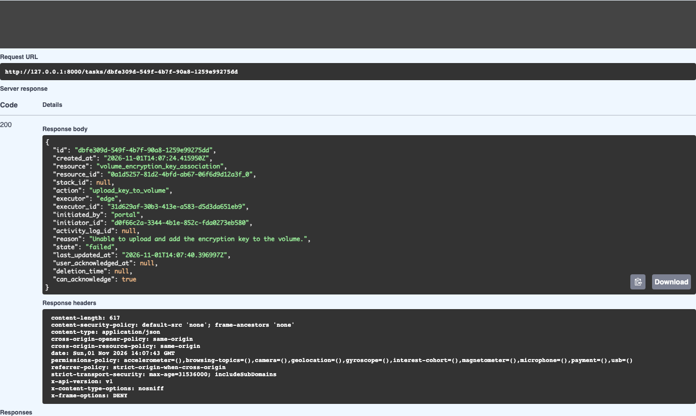

### 003_retry_upload_escrow_false_disable_false_volume_readback

`GET /volumes/{volume_id}/encryption-keys` — HTTP 200. [Full result](swagger/003_retry_upload_escrow_false_disable_false_volume_readback/result.json)

[Screenshot: 003_retry_upload_escrow_false_disable_false_volume_readback_parameters_01.png](swagger/003_retry_upload_escrow_false_disable_false_volume_readback/003_retry_upload_escrow_false_disable_false_volume_readback_parameters_01.png)

[Screenshot: 003_retry_upload_escrow_false_disable_false_volume_readback_response_01.png](swagger/003_retry_upload_escrow_false_disable_false_volume_readback/003_retry_upload_escrow_false_disable_false_volume_readback_response_01.png)

[Screenshot: 003_retry_upload_escrow_false_disable_false_volume_readback_response_02.png](swagger/003_retry_upload_escrow_false_disable_false_volume_readback/003_retry_upload_escrow_false_disable_false_volume_readback_response_02.png)

[Screenshot: 003_retry_upload_escrow_false_disable_false_volume_readback_response_03.png](swagger/003_retry_upload_escrow_false_disable_false_volume_readback/003_retry_upload_escrow_false_disable_false_volume_readback_response_03.png)

[Screenshot: 003_retry_upload_escrow_false_disable_false_volume_readback_response_04.png](swagger/003_retry_upload_escrow_false_disable_false_volume_readback/003_retry_upload_escrow_false_disable_false_volume_readback_response_04.png)

### 003_upload_escrow_false_disable_false

`POST /volumes/{volume_id}/encryption-keys/upload` — HTTP 400. [Full result](swagger/003_upload_escrow_false_disable_false/result.json)

[Screenshot: 003_upload_escrow_false_disable_false_parameters_01.png](swagger/003_upload_escrow_false_disable_false/003_upload_escrow_false_disable_false_parameters_01.png)

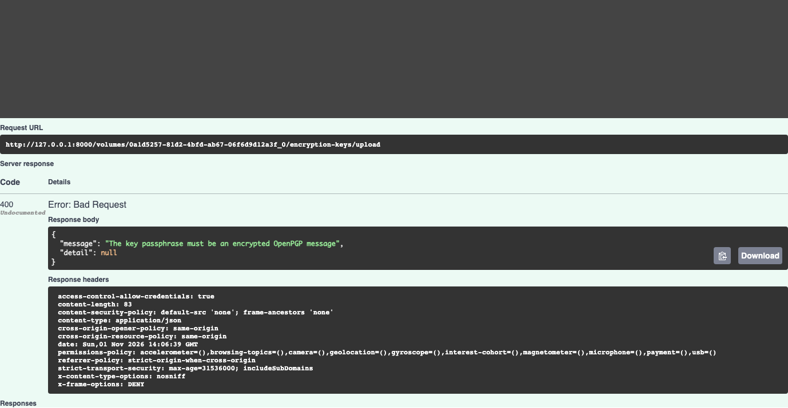

### 007_retry_upload_escrow_false_disable_false

`POST /volumes/{volume_id}/encryption-keys/upload` — HTTP 202. [Full result](swagger/007_retry_upload_escrow_false_disable_false/result.json)

[Screenshot: 007_retry_upload_escrow_false_disable_false_parameters_01.png](swagger/007_retry_upload_escrow_false_disable_false/007_retry_upload_escrow_false_disable_false_parameters_01.png)

### 007_retry_upload_escrow_false_disable_false_terminal_task

`GET /tasks/{task_id}` — HTTP 200. [Full result](swagger/007_retry_upload_escrow_false_disable_false_terminal_task/result.json)

[Screenshot: 007_retry_upload_escrow_false_disable_false_terminal_task_parameters_01.png](swagger/007_retry_upload_escrow_false_disable_false_terminal_task/007_retry_upload_escrow_false_disable_false_terminal_task_parameters_01.png)

### 007_retry_upload_escrow_false_disable_false_volume_readback

`GET /volumes/{volume_id}/encryption-keys` — HTTP 200. [Full result](swagger/007_retry_upload_escrow_false_disable_false_volume_readback/result.json)

[Screenshot: 007_retry_upload_escrow_false_disable_false_volume_readback_parameters_01.png](swagger/007_retry_upload_escrow_false_disable_false_volume_readback/007_retry_upload_escrow_false_disable_false_volume_readback_parameters_01.png)

[Screenshot: 007_retry_upload_escrow_false_disable_false_volume_readback_response_01.png](swagger/007_retry_upload_escrow_false_disable_false_volume_readback/007_retry_upload_escrow_false_disable_false_volume_readback_response_01.png)

[Screenshot: 007_retry_upload_escrow_false_disable_false_volume_readback_response_02.png](swagger/007_retry_upload_escrow_false_disable_false_volume_readback/007_retry_upload_escrow_false_disable_false_volume_readback_response_02.png)

[Screenshot: 007_retry_upload_escrow_false_disable_false_volume_readback_response_03.png](swagger/007_retry_upload_escrow_false_disable_false_volume_readback/007_retry_upload_escrow_false_disable_false_volume_readback_response_03.png)

[Screenshot: 007_retry_upload_escrow_false_disable_false_volume_readback_response_04.png](swagger/007_retry_upload_escrow_false_disable_false_volume_readback/007_retry_upload_escrow_false_disable_false_volume_readback_response_04.png)

### 008_retry_upload_escrow_true_disable_false

`POST /volumes/{volume_id}/encryption-keys/upload` — HTTP 202. [Full result](swagger/008_retry_upload_escrow_true_disable_false/result.json)

[Screenshot: 008_retry_upload_escrow_true_disable_false_parameters_01.png](swagger/008_retry_upload_escrow_true_disable_false/008_retry_upload_escrow_true_disable_false_parameters_01.png)

### 008_retry_upload_escrow_true_disable_false_key_readback

`GET /encryption-keys/{key_id}` — HTTP 200. [Full result](swagger/008_retry_upload_escrow_true_disable_false_key_readback/result.json)

[Screenshot: 008_retry_upload_escrow_true_disable_false_key_readback_parameters_01.png](swagger/008_retry_upload_escrow_true_disable_false_key_readback/008_retry_upload_escrow_true_disable_false_key_readback_parameters_01.png)

[Screenshot: 008_retry_upload_escrow_true_disable_false_key_readback_response_01.png](swagger/008_retry_upload_escrow_true_disable_false_key_readback/008_retry_upload_escrow_true_disable_false_key_readback_response_01.png)

[Screenshot: 008_retry_upload_escrow_true_disable_false_key_readback_response_02.png](swagger/008_retry_upload_escrow_true_disable_false_key_readback/008_retry_upload_escrow_true_disable_false_key_readback_response_02.png)

### 008_retry_upload_escrow_true_disable_false_terminal_task

`GET /tasks/{task_id}` — HTTP 200. [Full result](swagger/008_retry_upload_escrow_true_disable_false_terminal_task/result.json)

[Screenshot: 008_retry_upload_escrow_true_disable_false_terminal_task_parameters_01.png](swagger/008_retry_upload_escrow_true_disable_false_terminal_task/008_retry_upload_escrow_true_disable_false_terminal_task_parameters_01.png)

### 008_retry_upload_escrow_true_disable_false_volume_readback

`GET /volumes/{volume_id}/encryption-keys` — HTTP 200. [Full result](swagger/008_retry_upload_escrow_true_disable_false_volume_readback/result.json)

[Screenshot: 008_retry_upload_escrow_true_disable_false_volume_readback_parameters_01.png](swagger/008_retry_upload_escrow_true_disable_false_volume_readback/008_retry_upload_escrow_true_disable_false_volume_readback_parameters_01.png)

[Screenshot: 008_retry_upload_escrow_true_disable_false_volume_readback_response_01.png](swagger/008_retry_upload_escrow_true_disable_false_volume_readback/008_retry_upload_escrow_true_disable_false_volume_readback_response_01.png)

[Screenshot: 008_retry_upload_escrow_true_disable_false_volume_readback_response_02.png](swagger/008_retry_upload_escrow_true_disable_false_volume_readback/008_retry_upload_escrow_true_disable_false_volume_readback_response_02.png)

[Screenshot: 008_retry_upload_escrow_true_disable_false_volume_readback_response_03.png](swagger/008_retry_upload_escrow_true_disable_false_volume_readback/008_retry_upload_escrow_true_disable_false_volume_readback_response_03.png)

[Screenshot: 008_retry_upload_escrow_true_disable_false_volume_readback_response_04.png](swagger/008_retry_upload_escrow_true_disable_false_volume_readback/008_retry_upload_escrow_true_disable_false_volume_readback_response_04.png)

[Screenshot: 008_retry_upload_escrow_true_disable_false_volume_readback_response_05.png](swagger/008_retry_upload_escrow_true_disable_false_volume_readback/008_retry_upload_escrow_true_disable_false_volume_readback_response_05.png)

### 009_retry_upload_escrow_false_disable_true

`POST /volumes/{volume_id}/encryption-keys/upload` — HTTP 202. [Full result](swagger/009_retry_upload_escrow_false_disable_true/result.json)

[Screenshot: 009_retry_upload_escrow_false_disable_true_parameters_01.png](swagger/009_retry_upload_escrow_false_disable_true/009_retry_upload_escrow_false_disable_true_parameters_01.png)

### 009_retry_upload_escrow_false_disable_true_key_readback

`GET /encryption-keys/{key_id}` — HTTP 200. [Full result](swagger/009_retry_upload_escrow_false_disable_true_key_readback/result.json)

[Screenshot: 009_retry_upload_escrow_false_disable_true_key_readback_parameters_01.png](swagger/009_retry_upload_escrow_false_disable_true_key_readback/009_retry_upload_escrow_false_disable_true_key_readback_parameters_01.png)

[Screenshot: 009_retry_upload_escrow_false_disable_true_key_readback_response_01.png](swagger/009_retry_upload_escrow_false_disable_true_key_readback/009_retry_upload_escrow_false_disable_true_key_readback_response_01.png)

[Screenshot: 009_retry_upload_escrow_false_disable_true_key_readback_response_02.png](swagger/009_retry_upload_escrow_false_disable_true_key_readback/009_retry_upload_escrow_false_disable_true_key_readback_response_02.png)

### 009_retry_upload_escrow_false_disable_true_terminal_task

`GET /tasks/{task_id}` — HTTP 200. [Full result](swagger/009_retry_upload_escrow_false_disable_true_terminal_task/result.json)

[Screenshot: 009_retry_upload_escrow_false_disable_true_terminal_task_parameters_01.png](swagger/009_retry_upload_escrow_false_disable_true_terminal_task/009_retry_upload_escrow_false_disable_true_terminal_task_parameters_01.png)

### 009_retry_upload_escrow_false_disable_true_volume_readback

`GET /volumes/{volume_id}/encryption-keys` — HTTP 200. [Full result](swagger/009_retry_upload_escrow_false_disable_true_volume_readback/result.json)

[Screenshot: 009_retry_upload_escrow_false_disable_true_volume_readback_parameters_01.png](swagger/009_retry_upload_escrow_false_disable_true_volume_readback/009_retry_upload_escrow_false_disable_true_volume_readback_parameters_01.png)

[Screenshot: 009_retry_upload_escrow_false_disable_true_volume_readback_response_01.png](swagger/009_retry_upload_escrow_false_disable_true_volume_readback/009_retry_upload_escrow_false_disable_true_volume_readback_response_01.png)

[Screenshot: 009_retry_upload_escrow_false_disable_true_volume_readback_response_02.png](swagger/009_retry_upload_escrow_false_disable_true_volume_readback/009_retry_upload_escrow_false_disable_true_volume_readback_response_02.png)

[Screenshot: 009_retry_upload_escrow_false_disable_true_volume_readback_response_03.png](swagger/009_retry_upload_escrow_false_disable_true_volume_readback/009_retry_upload_escrow_false_disable_true_volume_readback_response_03.png)

[Screenshot: 009_retry_upload_escrow_false_disable_true_volume_readback_response_04.png](swagger/009_retry_upload_escrow_false_disable_true_volume_readback/009_retry_upload_escrow_false_disable_true_volume_readback_response_04.png)

[Screenshot: 009_retry_upload_escrow_false_disable_true_volume_readback_response_05.png](swagger/009_retry_upload_escrow_false_disable_true_volume_readback/009_retry_upload_escrow_false_disable_true_volume_readback_response_05.png)

### 010_retry_upload_escrow_true_disable_true

`POST /volumes/{volume_id}/encryption-keys/upload` — HTTP 202. [Full result](swagger/010_retry_upload_escrow_true_disable_true/result.json)

[Screenshot: 010_retry_upload_escrow_true_disable_true_parameters_01.png](swagger/010_retry_upload_escrow_true_disable_true/010_retry_upload_escrow_true_disable_true_parameters_01.png)

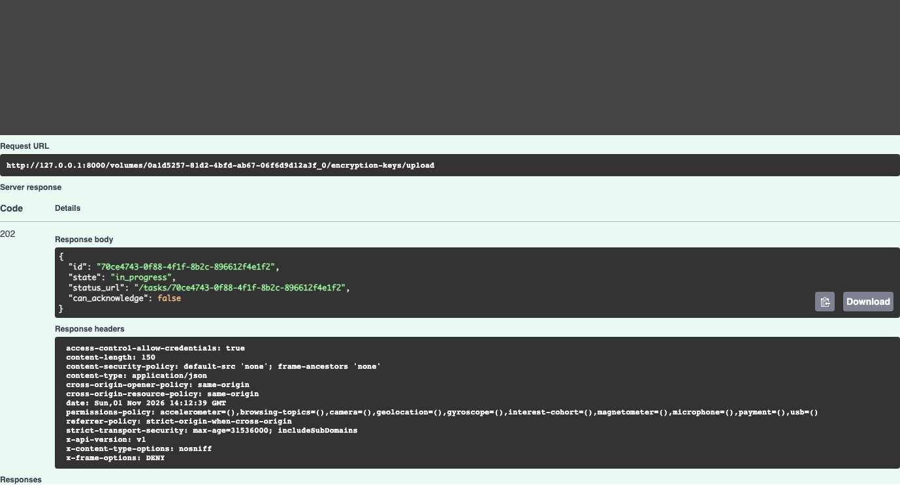

### 010_retry_upload_escrow_true_disable_true_key_readback

`GET /encryption-keys/{key_id}` — HTTP 200. [Full result](swagger/010_retry_upload_escrow_true_disable_true_key_readback/result.json)

[Screenshot: 010_retry_upload_escrow_true_disable_true_key_readback_parameters_01.png](swagger/010_retry_upload_escrow_true_disable_true_key_readback/010_retry_upload_escrow_true_disable_true_key_readback_parameters_01.png)

[Screenshot: 010_retry_upload_escrow_true_disable_true_key_readback_response_01.png](swagger/010_retry_upload_escrow_true_disable_true_key_readback/010_retry_upload_escrow_true_disable_true_key_readback_response_01.png)

[Screenshot: 010_retry_upload_escrow_true_disable_true_key_readback_response_02.png](swagger/010_retry_upload_escrow_true_disable_true_key_readback/010_retry_upload_escrow_true_disable_true_key_readback_response_02.png)

### 010_retry_upload_escrow_true_disable_true_terminal_task

`GET /tasks/{task_id}` — HTTP 200. [Full result](swagger/010_retry_upload_escrow_true_disable_true_terminal_task/result.json)

[Screenshot: 010_retry_upload_escrow_true_disable_true_terminal_task_parameters_01.png](swagger/010_retry_upload_escrow_true_disable_true_terminal_task/010_retry_upload_escrow_true_disable_true_terminal_task_parameters_01.png)

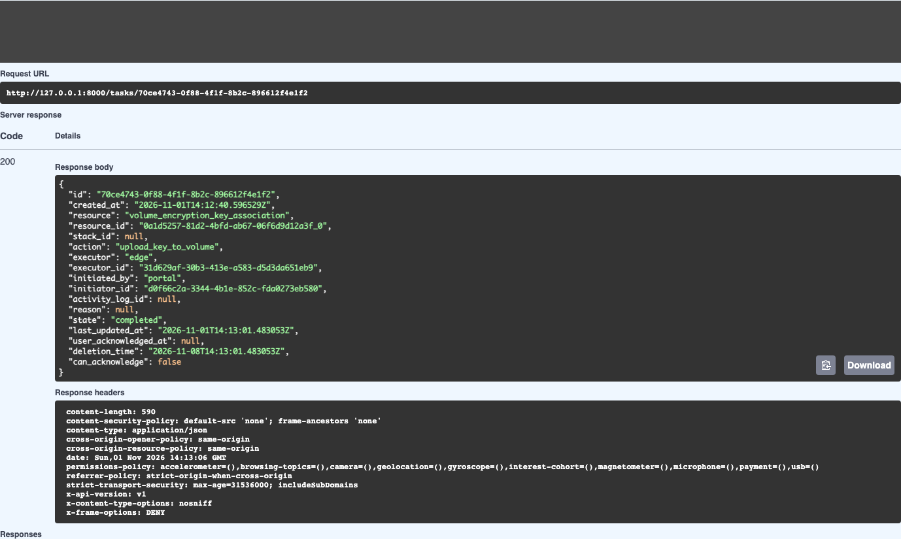

### 010_retry_upload_escrow_true_disable_true_volume_readback

`GET /volumes/{volume_id}/encryption-keys` — HTTP 200. [Full result](swagger/010_retry_upload_escrow_true_disable_true_volume_readback/result.json)

[Screenshot: 010_retry_upload_escrow_true_disable_true_volume_readback_parameters_01.png](swagger/010_retry_upload_escrow_true_disable_true_volume_readback/010_retry_upload_escrow_true_disable_true_volume_readback_parameters_01.png)

[Screenshot: 010_retry_upload_escrow_true_disable_true_volume_readback_response_01.png](swagger/010_retry_upload_escrow_true_disable_true_volume_readback/010_retry_upload_escrow_true_disable_true_volume_readback_response_01.png)

[Screenshot: 010_retry_upload_escrow_true_disable_true_volume_readback_response_02.png](swagger/010_retry_upload_escrow_true_disable_true_volume_readback/010_retry_upload_escrow_true_disable_true_volume_readback_response_02.png)

[Screenshot: 010_retry_upload_escrow_true_disable_true_volume_readback_response_03.png](swagger/010_retry_upload_escrow_true_disable_true_volume_readback/010_retry_upload_escrow_true_disable_true_volume_readback_response_03.png)

[Screenshot: 010_retry_upload_escrow_true_disable_true_volume_readback_response_04.png](swagger/010_retry_upload_escrow_true_disable_true_volume_readback/010_retry_upload_escrow_true_disable_true_volume_readback_response_04.png)

[Screenshot: 010_retry_upload_escrow_true_disable_true_volume_readback_response_05.png](swagger/010_retry_upload_escrow_true_disable_true_volume_readback/010_retry_upload_escrow_true_disable_true_volume_readback_response_05.png)

[Screenshot: 010_retry_upload_escrow_true_disable_true_volume_readback_response_06.png](swagger/010_retry_upload_escrow_true_disable_true_volume_readback/010_retry_upload_escrow_true_disable_true_volume_readback_response_06.png)

### 100_unauthenticated_upload

`POST /volumes/{volume_id}/encryption-keys/upload` — HTTP 401. [Full result](swagger/100_unauthenticated_upload/result.json)

[Screenshot: 100_unauthenticated_upload_parameters_01.png](swagger/100_unauthenticated_upload/100_unauthenticated_upload_parameters_01.png)

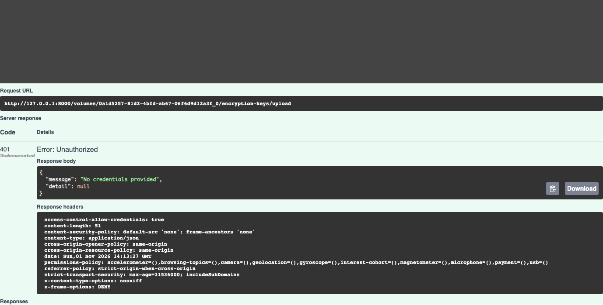

### 101_duplicate_fingerprint_upload

`POST /volumes/{volume_id}/encryption-keys/upload` — HTTP 202. [Full result](swagger/101_duplicate_fingerprint_upload/result.json)

[Screenshot: 101_duplicate_fingerprint_upload_parameters_01.png](swagger/101_duplicate_fingerprint_upload/101_duplicate_fingerprint_upload_parameters_01.png)

### 102_duplicate_terminal_task

`GET /tasks/{task_id}` — HTTP 200. [Full result](swagger/102_duplicate_terminal_task/result.json)

[Screenshot: 102_duplicate_terminal_task_parameters_01.png](swagger/102_duplicate_terminal_task/102_duplicate_terminal_task_parameters_01.png)

### 103_failed_volume_task_visibility

`GET /volumes/{volume_id}/encryption-keys` — HTTP 200. [Full result](swagger/103_failed_volume_task_visibility/result.json)

[Screenshot: 103_failed_volume_task_visibility_parameters_01.png](swagger/103_failed_volume_task_visibility/103_failed_volume_task_visibility_parameters_01.png)

[Screenshot: 103_failed_volume_task_visibility_response_01.png](swagger/103_failed_volume_task_visibility/103_failed_volume_task_visibility_response_01.png)

[Screenshot: 103_failed_volume_task_visibility_response_02.png](swagger/103_failed_volume_task_visibility/103_failed_volume_task_visibility_response_02.png)

[Screenshot: 103_failed_volume_task_visibility_response_03.png](swagger/103_failed_volume_task_visibility/103_failed_volume_task_visibility_response_03.png)

[Screenshot: 103_failed_volume_task_visibility_response_04.png](swagger/103_failed_volume_task_visibility/103_failed_volume_task_visibility_response_04.png)

[Screenshot: 103_failed_volume_task_visibility_response_05.png](swagger/103_failed_volume_task_visibility/103_failed_volume_task_visibility_response_05.png)

[Screenshot: 103_failed_volume_task_visibility_response_06.png](swagger/103_failed_volume_task_visibility/103_failed_volume_task_visibility_response_06.png)

### 104_acknowledge_duplicate_failure

`POST /tasks/{task_id}/acknowledge` — HTTP 204. [Full result](swagger/104_acknowledge_duplicate_failure/result.json)

[Screenshot: 104_acknowledge_duplicate_failure_parameters_01.png](swagger/104_acknowledge_duplicate_failure/104_acknowledge_duplicate_failure_parameters_01.png)

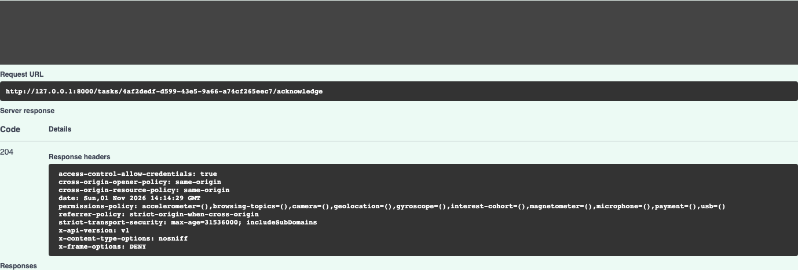

### 105_volume_after_failure_acknowledgement

`GET /volumes/{volume_id}/encryption-keys` — HTTP 200. [Full result](swagger/105_volume_after_failure_acknowledgement/result.json)

[Screenshot: 105_volume_after_failure_acknowledgement_parameters_01.png](swagger/105_volume_after_failure_acknowledgement/105_volume_after_failure_acknowledgement_parameters_01.png)

[Screenshot: 105_volume_after_failure_acknowledgement_response_01.png](swagger/105_volume_after_failure_acknowledgement/105_volume_after_failure_acknowledgement_response_01.png)

[Screenshot: 105_volume_after_failure_acknowledgement_response_02.png](swagger/105_volume_after_failure_acknowledgement/105_volume_after_failure_acknowledgement_response_02.png)

[Screenshot: 105_volume_after_failure_acknowledgement_response_03.png](swagger/105_volume_after_failure_acknowledgement/105_volume_after_failure_acknowledgement_response_03.png)

[Screenshot: 105_volume_after_failure_acknowledgement_response_04.png](swagger/105_volume_after_failure_acknowledgement/105_volume_after_failure_acknowledgement_response_04.png)

[Screenshot: 105_volume_after_failure_acknowledgement_response_05.png](swagger/105_volume_after_failure_acknowledgement/105_volume_after_failure_acknowledgement_response_05.png)

[Screenshot: 105_volume_after_failure_acknowledgement_response_06.png](swagger/105_volume_after_failure_acknowledgement/105_volume_after_failure_acknowledgement_response_06.png)

### 200_restore_01_enable

`POST /volumes/{volume_id}/encryption-keys/{key_id}/enable` — HTTP 202. [Full result](swagger/200_restore_01_enable/result.json)

[Screenshot: 200_restore_01_enable_parameters_01.png](swagger/200_restore_01_enable/200_restore_01_enable_parameters_01.png)

### 200_restore_02_enable

`POST /volumes/{volume_id}/encryption-keys/{key_id}/enable` — HTTP 202. [Full result](swagger/200_restore_02_enable/result.json)

[Screenshot: 200_restore_02_enable_parameters_01.png](swagger/200_restore_02_enable/200_restore_02_enable_parameters_01.png)

### 200_restore_03_enable

`POST /volumes/{volume_id}/encryption-keys/{key_id}/enable` — HTTP 202. [Full result](swagger/200_restore_03_enable/result.json)

[Screenshot: 200_restore_03_enable_parameters_01.png](swagger/200_restore_03_enable/200_restore_03_enable_parameters_01.png)

### 200_restore_04_enable

`POST /volumes/{volume_id}/encryption-keys/{key_id}/enable` — HTTP 202. [Full result](swagger/200_restore_04_enable/result.json)

[Screenshot: 200_restore_04_enable_parameters_01.png](swagger/200_restore_04_enable/200_restore_04_enable_parameters_01.png)

### 200_restore_05_enable

`POST /volumes/{volume_id}/encryption-keys/{key_id}/enable` — HTTP 202. [Full result](swagger/200_restore_05_enable/result.json)

[Screenshot: 200_restore_05_enable_parameters_01.png](swagger/200_restore_05_enable/200_restore_05_enable_parameters_01.png)

### 200_restore_06_disable

`POST /volumes/{volume_id}/encryption-keys/{key_id}/disable` — HTTP 202. [Full result](swagger/200_restore_06_disable/result.json)

[Screenshot: 200_restore_06_disable_parameters_01.png](swagger/200_restore_06_disable/200_restore_06_disable_parameters_01.png)

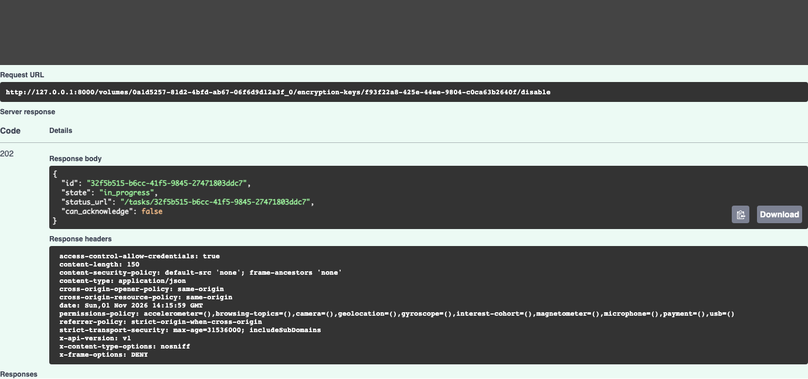

### 210_restored_volume_readback

`GET /volumes/{volume_id}/encryption-keys` — HTTP 200. [Full result](swagger/210_restored_volume_readback/result.json)

[Screenshot: 210_restored_volume_readback_parameters_01.png](swagger/210_restored_volume_readback/210_restored_volume_readback_parameters_01.png)

[Screenshot: 210_restored_volume_readback_response_01.png](swagger/210_restored_volume_readback/210_restored_volume_readback_response_01.png)

[Screenshot: 210_restored_volume_readback_response_02.png](swagger/210_restored_volume_readback/210_restored_volume_readback_response_02.png)

[Screenshot: 210_restored_volume_readback_response_03.png](swagger/210_restored_volume_readback/210_restored_volume_readback_response_03.png)

[Screenshot: 210_restored_volume_readback_response_04.png](swagger/210_restored_volume_readback/210_restored_volume_readback_response_04.png)

[Screenshot: 210_restored_volume_readback_response_05.png](swagger/210_restored_volume_readback/210_restored_volume_readback_response_05.png)

[Screenshot: 210_restored_volume_readback_response_06.png](swagger/210_restored_volume_readback/210_restored_volume_readback_response_06.png)

### 211_final_appliance_summary

`GET /edges/{appliance_id}/encryption-keys/summary` — HTTP 200. [Full result](swagger/211_final_appliance_summary/result.json)

[Screenshot: 211_final_appliance_summary_parameters_01.png](swagger/211_final_appliance_summary/211_final_appliance_summary_parameters_01.png)

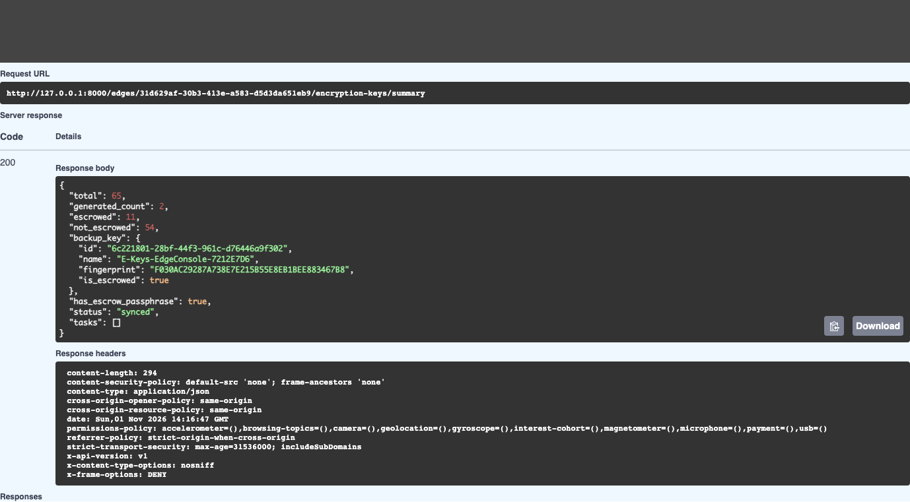

## Rendered database and filer evidence

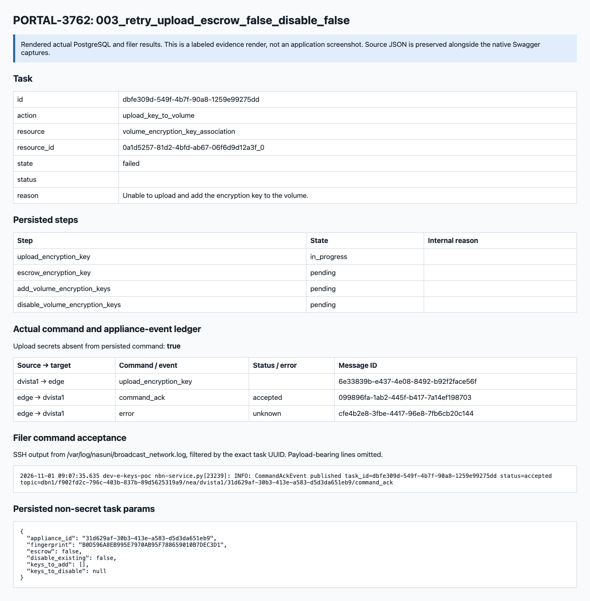

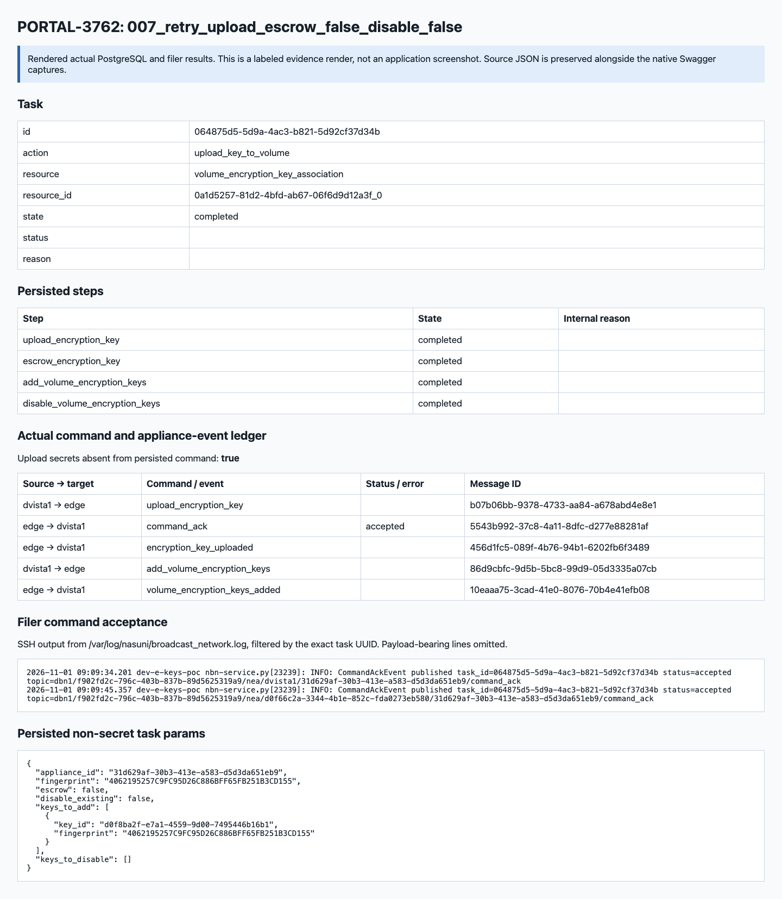

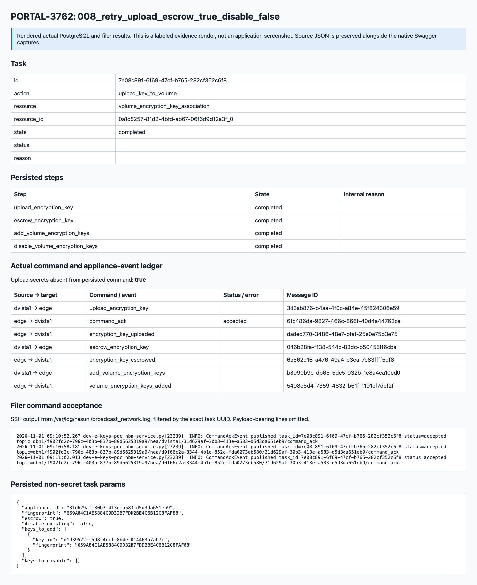

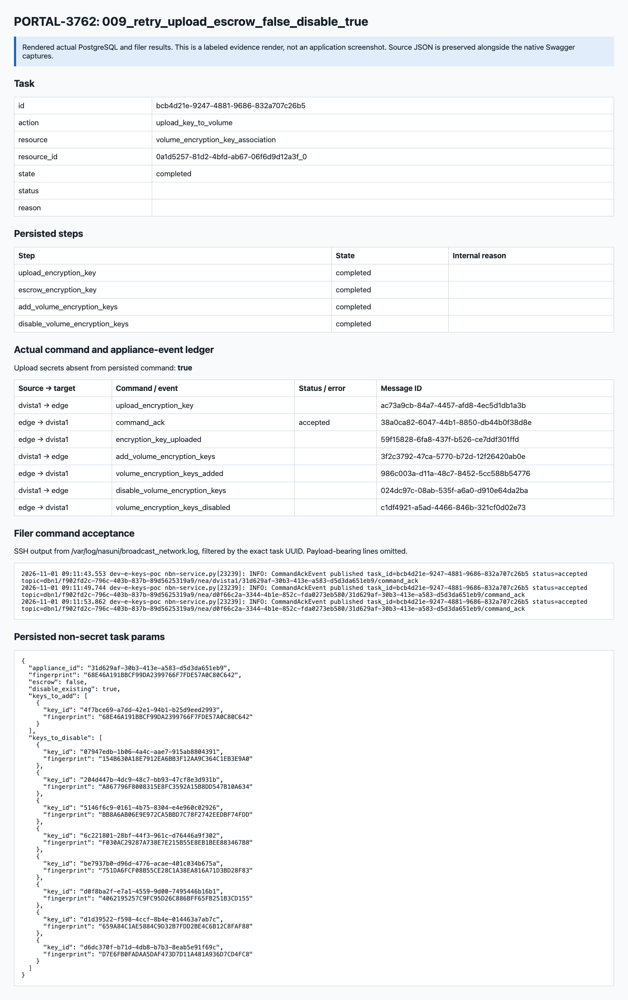

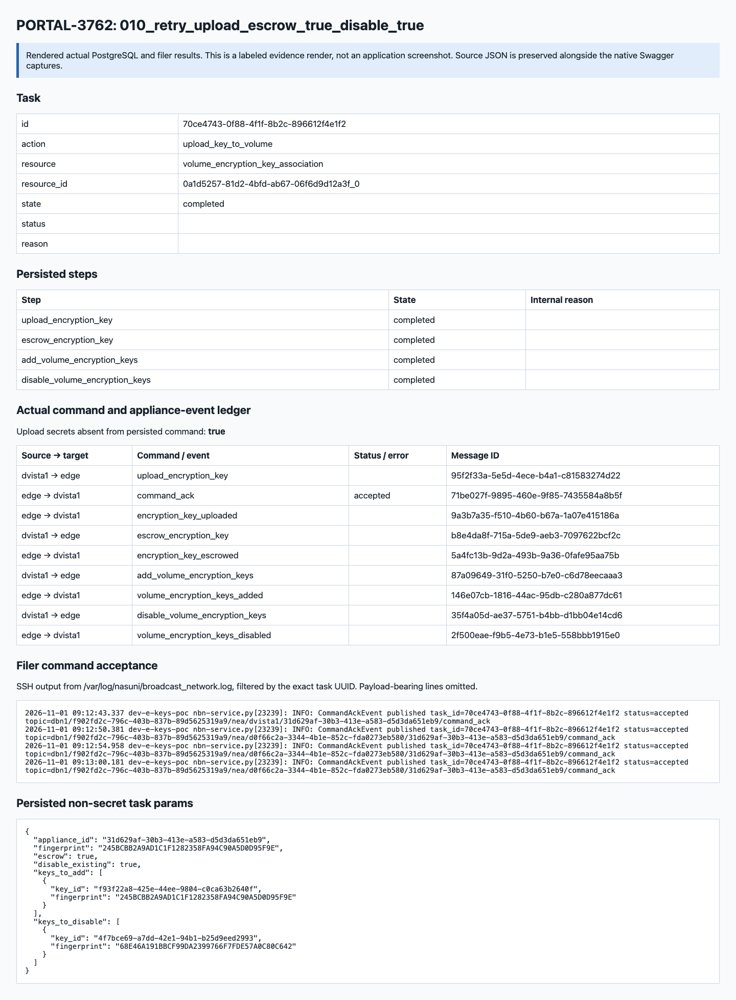

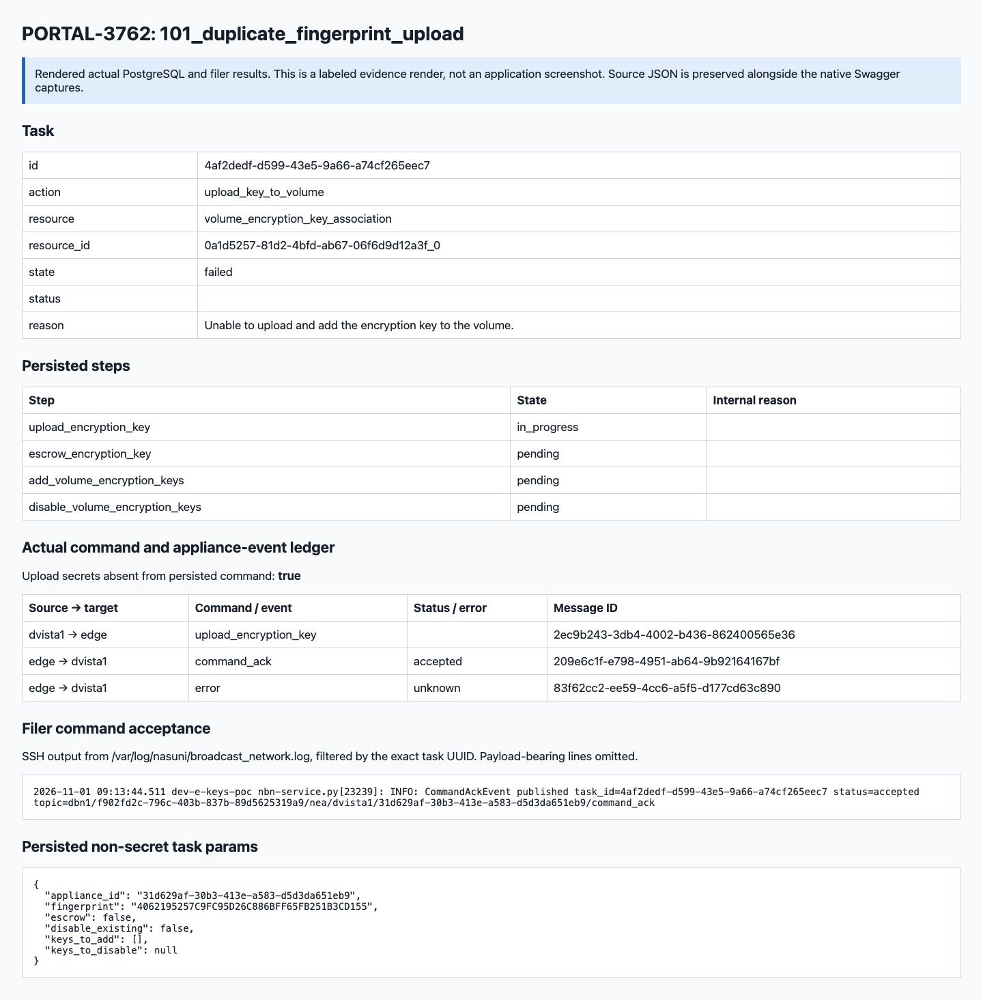

## Filer log sources

- [003_retry_upload_escrow_false_disable_false](filer/003_retry_upload_escrow_false_disable_false.json)
- [007_retry_upload_escrow_false_disable_false](filer/007_retry_upload_escrow_false_disable_false.json)
- [008_retry_upload_escrow_true_disable_false](filer/008_retry_upload_escrow_true_disable_false.json)
- [009_retry_upload_escrow_false_disable_true](filer/009_retry_upload_escrow_false_disable_true.json)
- [010_retry_upload_escrow_true_disable_true](filer/010_retry_upload_escrow_true_disable_true.json)
- [baseline-state-restoration](filer/baseline-state-restoration.json)
- [baseline-tail-50](filer/baseline-tail-50.json)
- [duplicate-upload](filer/duplicate-upload.json)
