# PORTAL-3762: protected-key upload retest

**All four password-protected key workflows completed on the real filer after removing the incorrect PGP validation of the upload unlock passphrase.**

This corrects the earlier diagnosis: the failure was introduced by Portal’s new volume-upload validation, not established as a filer-version compatibility issue. The existing appliance upload accepts the plaintext unlock passphrase as `SecretStr` and forwards it unchanged inside the encrypted command envelope. The encrypted key-file checks remain in place.

Baseline commit: `69559978ecf3e7da43e1b318126223fbae03448f` plus the **uncommitted local fix** described in [tested source metadata](tested-source.json). The tested diff SHA-256 identifies the exact local change. No application commit or push is claimed.

273 focused unit tests passed. The live retest captured 23 native Swagger requests and 82 screenshots, with every displayed response verified against the browser’s actual network response.

| Escrow | Disable existing | Task | Result |
| --- | --- | --- | --- |
| false | false | `4a91308e-279f-4edd-a10a-2d95effb70e0` | [All checks passed](swagger/001_protected_upload_escrow_false_disable_false/assertions.json) |
| true | false | `abb0770b-45e7-4377-bf8b-c4728421e6cd` | [All checks passed](swagger/002_protected_upload_escrow_true_disable_false/assertions.json) |
| false | true | `de20380e-614a-4af0-83db-07feaa44ef8a` | [All checks passed](swagger/003_protected_upload_escrow_false_disable_true/assertions.json) |
| true | true | `c8120799-d07b-44f5-86c5-950b0f7e1b29` | [All checks passed](swagger/004_protected_upload_escrow_true_disable_true/assertions.json) |

Every key was generated with GnuPG RSA3072 primary certify/sign and encryption subkeys, protected by its own nonempty random unlock passphrase, then encrypted to the filer public key. Unlock passphrases remained in process/browser memory. The stored message records exclude upload secrets; no plaintext unlock passphrases were written to test inputs or published evidence.

Verified real Upload/Escrow/Add/Disable confirmations, exact requested command order, optional-step completion, saved Disable targets, appliance-reported names, no stubs, and volume-only task surfacing.

## Test controls and final state

- Account `f902fd2c-796c-403b-837b-89d5625319a9`; filer `31d629af-30b3-413e-a583-d5d3da651eb9`; volume `0a1d5257-81d2-4bfd-ab67-06f6d9d12a3f_0`.
- `include_in_schema=True` was enabled only for local Swagger testing and restored to `False`; the final served OpenAPI schema hides the endpoint.
- Reused the explicitly authorized temporary minimum-version override from 10.6 to the selected filer’s 10.5, then restored 10.6. These results do not establish testing on an actual 10.6 appliance.
- Temporarily enabled the account feature in the local cache and used successful SSH liveness observations for local readiness. Both controls were restored while preserving newer runtime state.
- Used the existing user’s stored permissions and real NOC Key Escrow license. The configured appliance escrow passphrase was not changed. Authentication used a locally signed JWT for the existing user; external IdP login was not exercised.
- Real NBN responses were processed by the running Docker EventHub SQS poller. No synthetic confirmation events were used.
- Restored the baseline volume association states through real commands. Four newly confirmed protected test keys remain with disabled associations. Older test resources were preserved.

[Restoration](baseline-restoration.json) · [Temporary overrides](temporary-overrides.json) · [Control restoration](control-restoration.json) · [Plaintext secret scan](plaintext-secret-scan.json)

## Evidence

### 001_protected_upload_escrow_false_disable_false

[Task and steps](swagger/001_protected_upload_escrow_false_disable_false/terminal-database.json) · [Command/event ledger](swagger/001_protected_upload_escrow_false_disable_false/command-event-ledger.json) · [Filer acceptance logs](filer/001_protected_upload_escrow_false_disable_false.json)

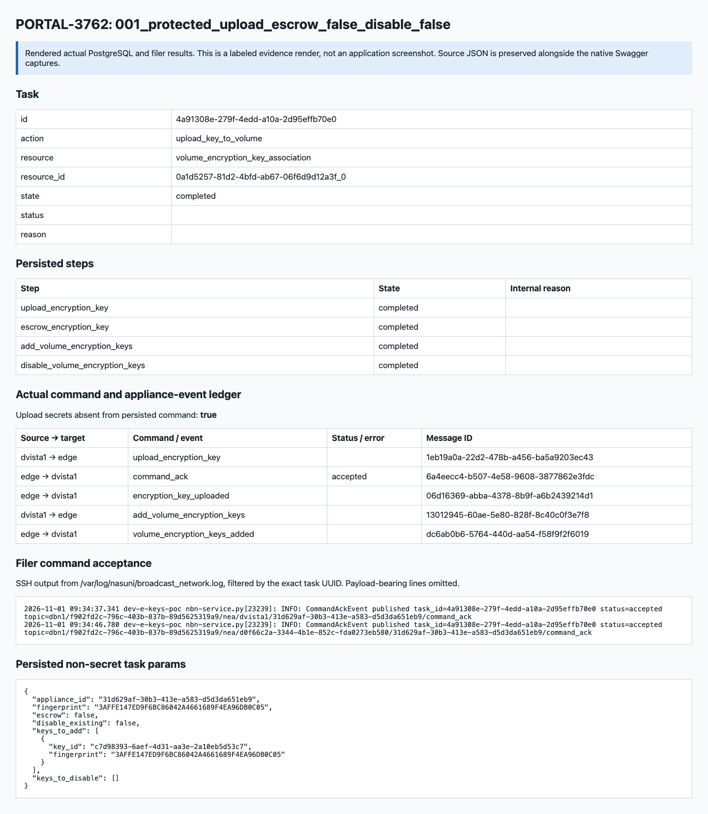

### 002_protected_upload_escrow_true_disable_false

[Task and steps](swagger/002_protected_upload_escrow_true_disable_false/terminal-database.json) · [Command/event ledger](swagger/002_protected_upload_escrow_true_disable_false/command-event-ledger.json) · [Filer acceptance logs](filer/002_protected_upload_escrow_true_disable_false.json)

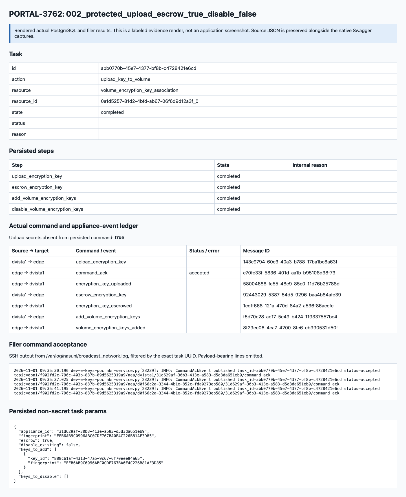

### 003_protected_upload_escrow_false_disable_true

[Task and steps](swagger/003_protected_upload_escrow_false_disable_true/terminal-database.json) · [Command/event ledger](swagger/003_protected_upload_escrow_false_disable_true/command-event-ledger.json) · [Filer acceptance logs](filer/003_protected_upload_escrow_false_disable_true.json)

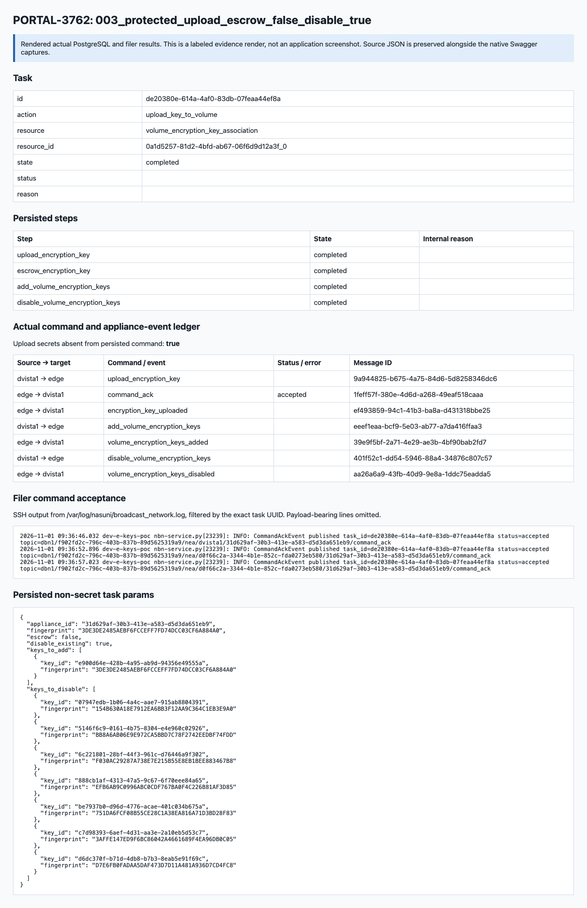

### 004_protected_upload_escrow_true_disable_true

[Task and steps](swagger/004_protected_upload_escrow_true_disable_true/terminal-database.json) · [Command/event ledger](swagger/004_protected_upload_escrow_true_disable_true/command-event-ledger.json) · [Filer acceptance logs](filer/004_protected_upload_escrow_true_disable_true.json)

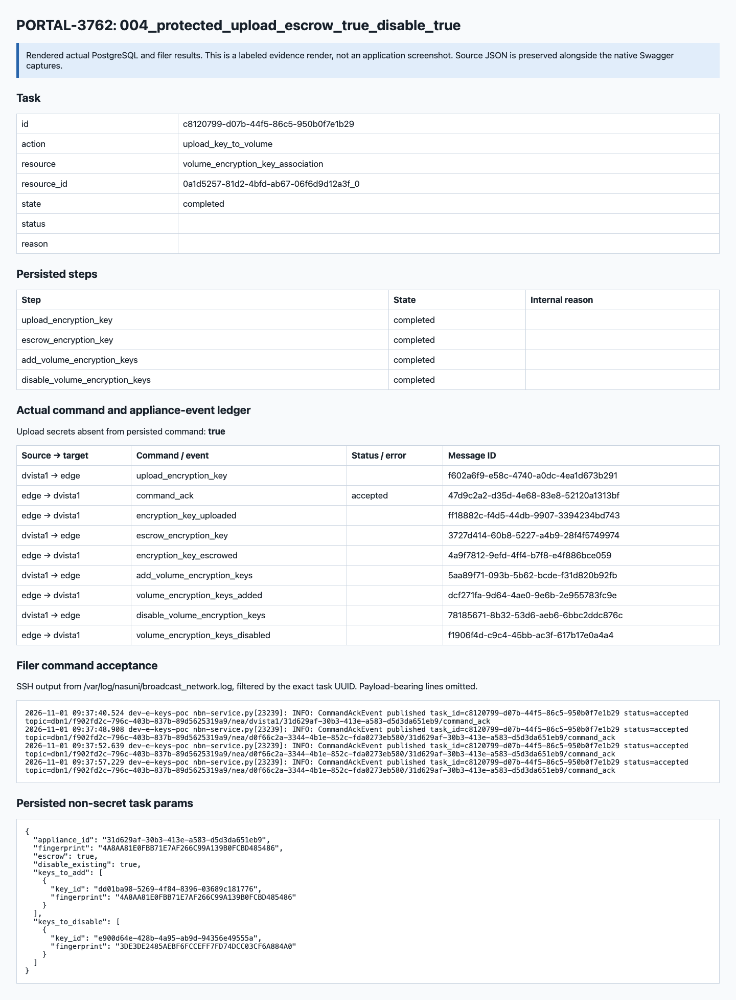

### Native Swagger: 001_protected_upload_escrow_false_disable_false

`POST /volumes/{volume_id}/encryption-keys/upload` — HTTP 202. [Actual response](swagger/001_protected_upload_escrow_false_disable_false/result.json)

[Native request controls](swagger/001_protected_upload_escrow_false_disable_false/001_protected_upload_escrow_false_disable_false_parameters_01.png)

### Native Swagger: 001_protected_upload_escrow_false_disable_false_key_readback

`GET /encryption-keys/{key_id}` — HTTP 200. [Actual response](swagger/001_protected_upload_escrow_false_disable_false_key_readback/result.json)

[Native request controls](swagger/001_protected_upload_escrow_false_disable_false_key_readback/001_protected_upload_escrow_false_disable_false_key_readback_parameters_01.png)

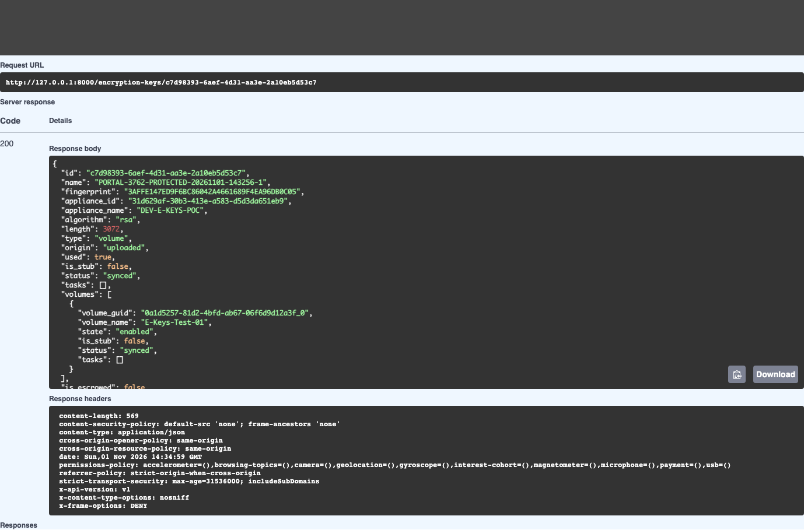

### Native Swagger: 001_protected_upload_escrow_false_disable_false_terminal_task

`GET /tasks/{task_id}` — HTTP 200. [Actual response](swagger/001_protected_upload_escrow_false_disable_false_terminal_task/result.json)

[Native request controls](swagger/001_protected_upload_escrow_false_disable_false_terminal_task/001_protected_upload_escrow_false_disable_false_terminal_task_parameters_01.png)

### Native Swagger: 001_protected_upload_escrow_false_disable_false_volume_readback

`GET /volumes/{volume_id}/encryption-keys` — HTTP 200. [Actual response](swagger/001_protected_upload_escrow_false_disable_false_volume_readback/result.json)

[Native request controls](swagger/001_protected_upload_escrow_false_disable_false_volume_readback/001_protected_upload_escrow_false_disable_false_volume_readback_parameters_01.png)

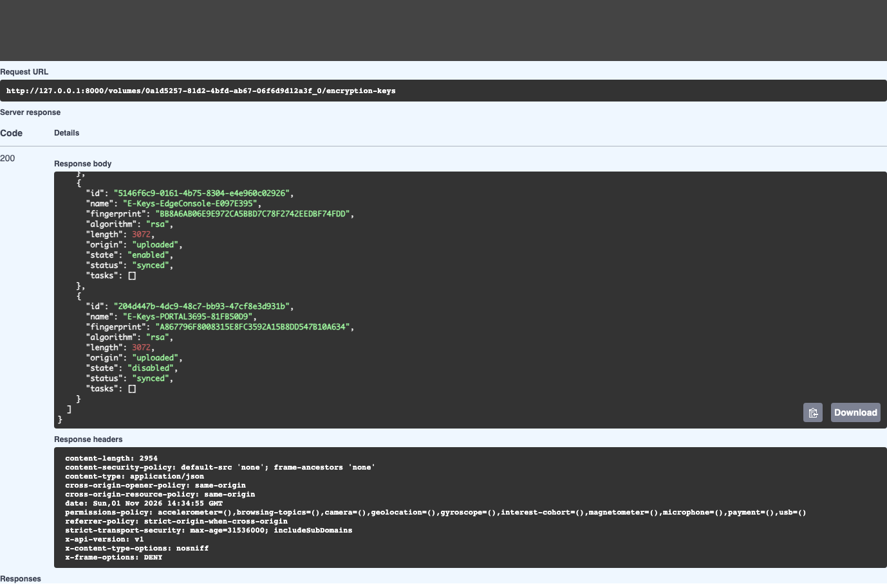

### Native Swagger: 002_protected_upload_escrow_true_disable_false

`POST /volumes/{volume_id}/encryption-keys/upload` — HTTP 202. [Actual response](swagger/002_protected_upload_escrow_true_disable_false/result.json)

[Native request controls](swagger/002_protected_upload_escrow_true_disable_false/002_protected_upload_escrow_true_disable_false_parameters_01.png)

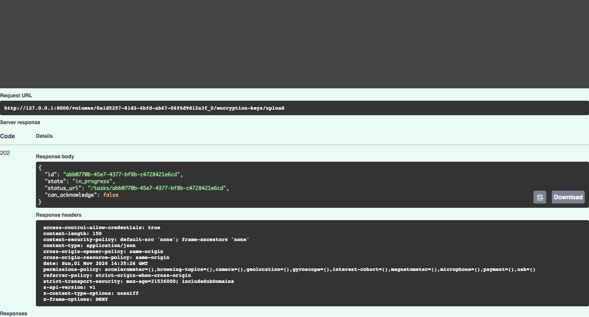

### Native Swagger: 002_protected_upload_escrow_true_disable_false_key_readback

`GET /encryption-keys/{key_id}` — HTTP 200. [Actual response](swagger/002_protected_upload_escrow_true_disable_false_key_readback/result.json)

[Native request controls](swagger/002_protected_upload_escrow_true_disable_false_key_readback/002_protected_upload_escrow_true_disable_false_key_readback_parameters_01.png)

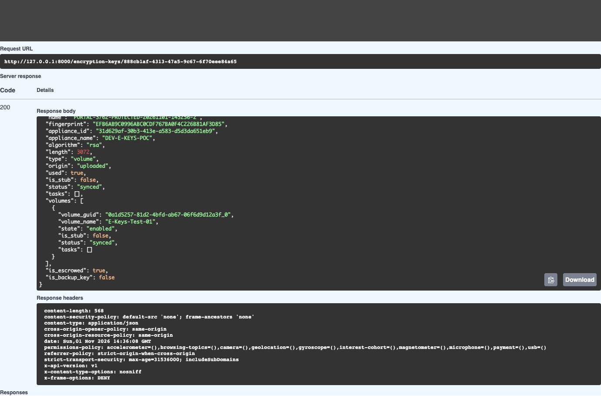

### Native Swagger: 002_protected_upload_escrow_true_disable_false_terminal_task

`GET /tasks/{task_id}` — HTTP 200. [Actual response](swagger/002_protected_upload_escrow_true_disable_false_terminal_task/result.json)

[Native request controls](swagger/002_protected_upload_escrow_true_disable_false_terminal_task/002_protected_upload_escrow_true_disable_false_terminal_task_parameters_01.png)

### Native Swagger: 002_protected_upload_escrow_true_disable_false_volume_readback

`GET /volumes/{volume_id}/encryption-keys` — HTTP 200. [Actual response](swagger/002_protected_upload_escrow_true_disable_false_volume_readback/result.json)

[Native request controls](swagger/002_protected_upload_escrow_true_disable_false_volume_readback/002_protected_upload_escrow_true_disable_false_volume_readback_parameters_01.png)

### Native Swagger: 003_protected_upload_escrow_false_disable_true

`POST /volumes/{volume_id}/encryption-keys/upload` — HTTP 202. [Actual response](swagger/003_protected_upload_escrow_false_disable_true/result.json)

[Native request controls](swagger/003_protected_upload_escrow_false_disable_true/003_protected_upload_escrow_false_disable_true_parameters_01.png)

### Native Swagger: 003_protected_upload_escrow_false_disable_true_key_readback

`GET /encryption-keys/{key_id}` — HTTP 200. [Actual response](swagger/003_protected_upload_escrow_false_disable_true_key_readback/result.json)

[Native request controls](swagger/003_protected_upload_escrow_false_disable_true_key_readback/003_protected_upload_escrow_false_disable_true_key_readback_parameters_01.png)

### Native Swagger: 003_protected_upload_escrow_false_disable_true_terminal_task

`GET /tasks/{task_id}` — HTTP 200. [Actual response](swagger/003_protected_upload_escrow_false_disable_true_terminal_task/result.json)

[Native request controls](swagger/003_protected_upload_escrow_false_disable_true_terminal_task/003_protected_upload_escrow_false_disable_true_terminal_task_parameters_01.png)

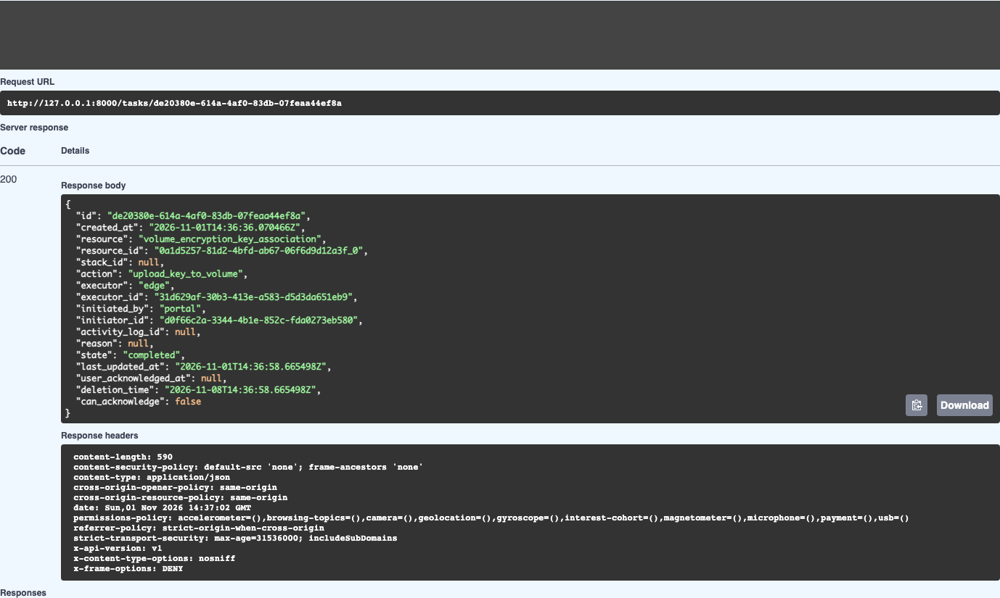

### Native Swagger: 003_protected_upload_escrow_false_disable_true_volume_readback

`GET /volumes/{volume_id}/encryption-keys` — HTTP 200. [Actual response](swagger/003_protected_upload_escrow_false_disable_true_volume_readback/result.json)

[Native request controls](swagger/003_protected_upload_escrow_false_disable_true_volume_readback/003_protected_upload_escrow_false_disable_true_volume_readback_parameters_01.png)

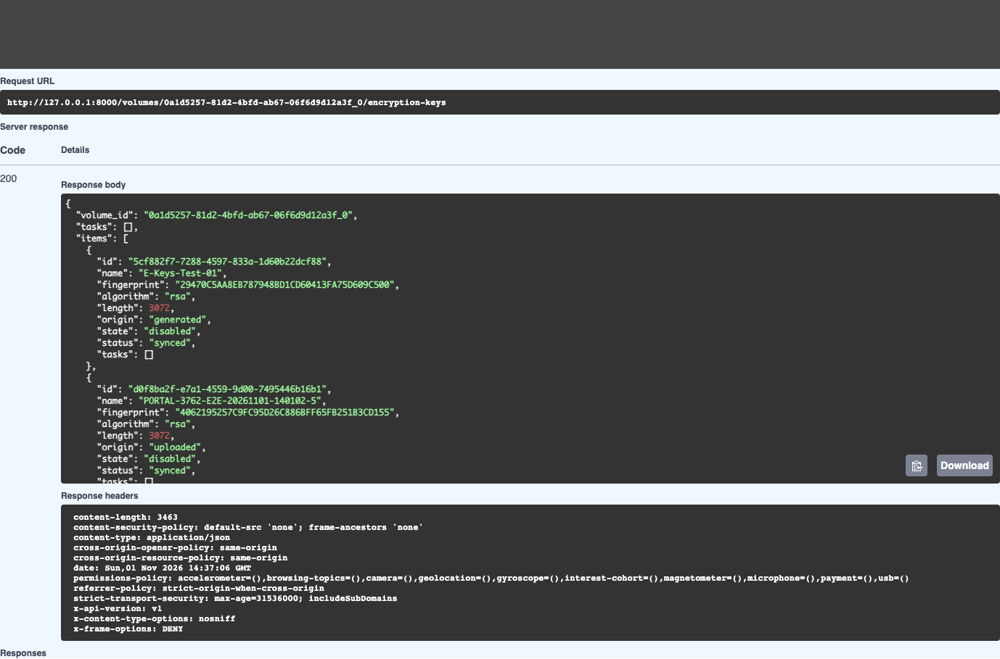

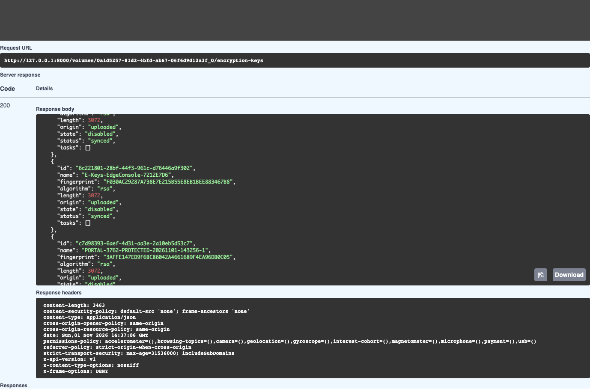

### Native Swagger: 004_protected_upload_escrow_true_disable_true

`POST /volumes/{volume_id}/encryption-keys/upload` — HTTP 202. [Actual response](swagger/004_protected_upload_escrow_true_disable_true/result.json)

[Native request controls](swagger/004_protected_upload_escrow_true_disable_true/004_protected_upload_escrow_true_disable_true_parameters_01.png)

### Native Swagger: 004_protected_upload_escrow_true_disable_true_key_readback

`GET /encryption-keys/{key_id}` — HTTP 200. [Actual response](swagger/004_protected_upload_escrow_true_disable_true_key_readback/result.json)

[Native request controls](swagger/004_protected_upload_escrow_true_disable_true_key_readback/004_protected_upload_escrow_true_disable_true_key_readback_parameters_01.png)

### Native Swagger: 004_protected_upload_escrow_true_disable_true_terminal_task

`GET /tasks/{task_id}` — HTTP 200. [Actual response](swagger/004_protected_upload_escrow_true_disable_true_terminal_task/result.json)

[Native request controls](swagger/004_protected_upload_escrow_true_disable_true_terminal_task/004_protected_upload_escrow_true_disable_true_terminal_task_parameters_01.png)

### Native Swagger: 004_protected_upload_escrow_true_disable_true_volume_readback

`GET /volumes/{volume_id}/encryption-keys` — HTTP 200. [Actual response](swagger/004_protected_upload_escrow_true_disable_true_volume_readback/result.json)

[Native request controls](swagger/004_protected_upload_escrow_true_disable_true_volume_readback/004_protected_upload_escrow_true_disable_true_volume_readback_parameters_01.png)

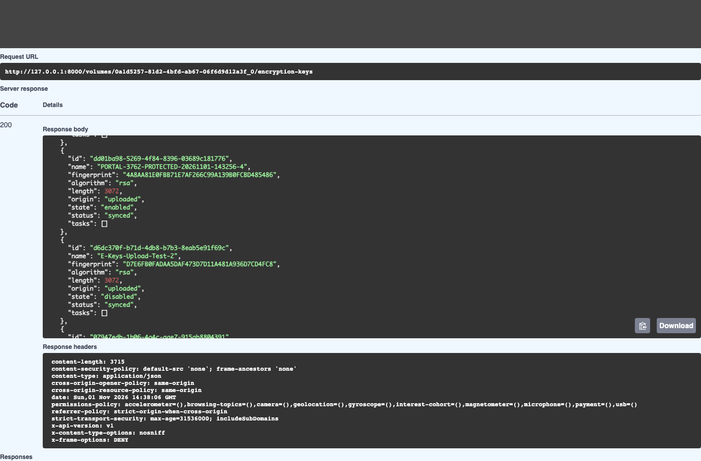

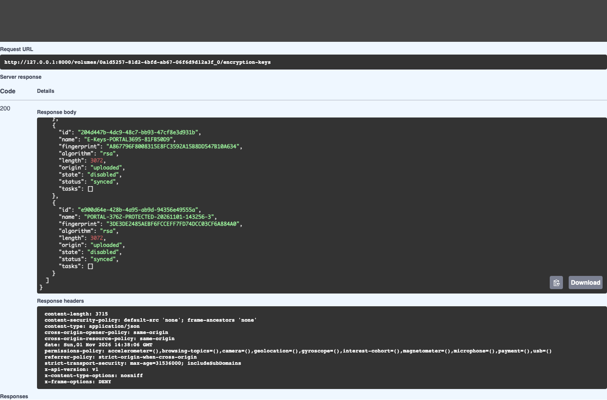

### Native Swagger: 200_restore_01_enable

`POST /volumes/{volume_id}/encryption-keys/{key_id}/enable` — HTTP 202. [Actual response](swagger/200_restore_01_enable/result.json)

[Native request controls](swagger/200_restore_01_enable/200_restore_01_enable_parameters_01.png)

### Native Swagger: 200_restore_02_enable

`POST /volumes/{volume_id}/encryption-keys/{key_id}/enable` — HTTP 202. [Actual response](swagger/200_restore_02_enable/result.json)

[Native request controls](swagger/200_restore_02_enable/200_restore_02_enable_parameters_01.png)

### Native Swagger: 200_restore_03_enable

`POST /volumes/{volume_id}/encryption-keys/{key_id}/enable` — HTTP 202. [Actual response](swagger/200_restore_03_enable/result.json)

[Native request controls](swagger/200_restore_03_enable/200_restore_03_enable_parameters_01.png)

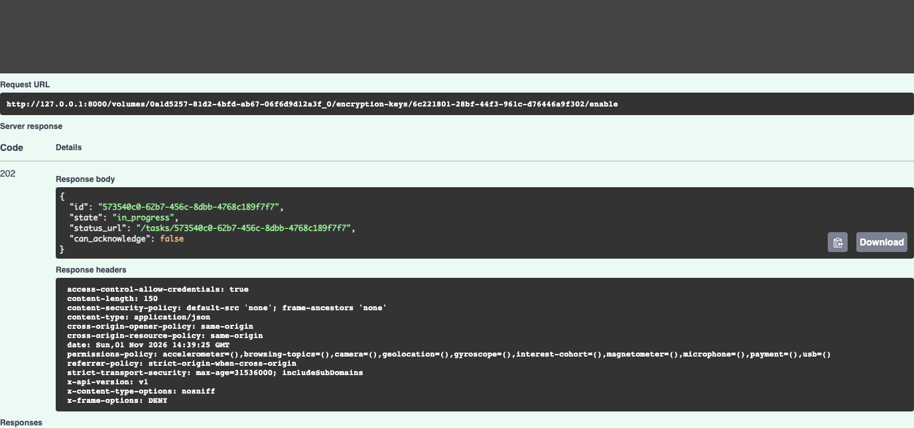

### Native Swagger: 200_restore_04_enable

`POST /volumes/{volume_id}/encryption-keys/{key_id}/enable` — HTTP 202. [Actual response](swagger/200_restore_04_enable/result.json)

[Native request controls](swagger/200_restore_04_enable/200_restore_04_enable_parameters_01.png)

### Native Swagger: 200_restore_05_enable

`POST /volumes/{volume_id}/encryption-keys/{key_id}/enable` — HTTP 202. [Actual response](swagger/200_restore_05_enable/result.json)

[Native request controls](swagger/200_restore_05_enable/200_restore_05_enable_parameters_01.png)

### Native Swagger: 200_restore_06_disable

`POST /volumes/{volume_id}/encryption-keys/{key_id}/disable` — HTTP 202. [Actual response](swagger/200_restore_06_disable/result.json)

[Native request controls](swagger/200_restore_06_disable/200_restore_06_disable_parameters_01.png)

### Native Swagger: 210_restored_volume_readback

`GET /volumes/{volume_id}/encryption-keys` — HTTP 200. [Actual response](swagger/210_restored_volume_readback/result.json)

[Native request controls](swagger/210_restored_volume_readback/210_restored_volume_readback_parameters_01.png)

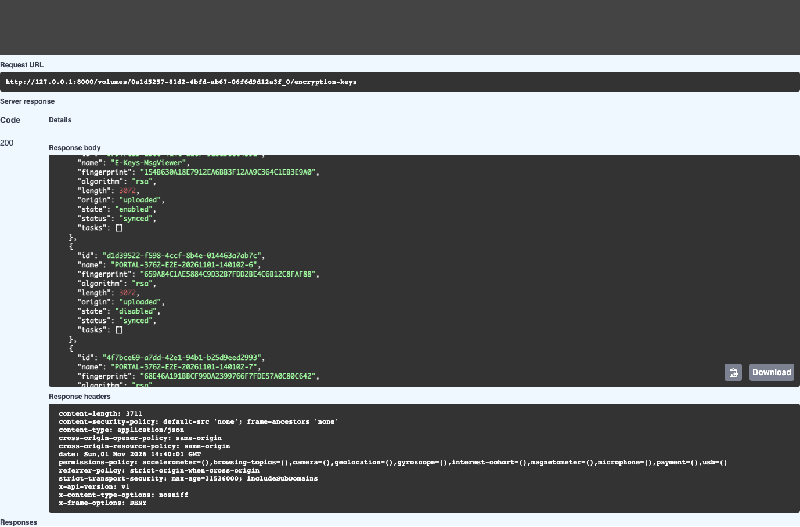

