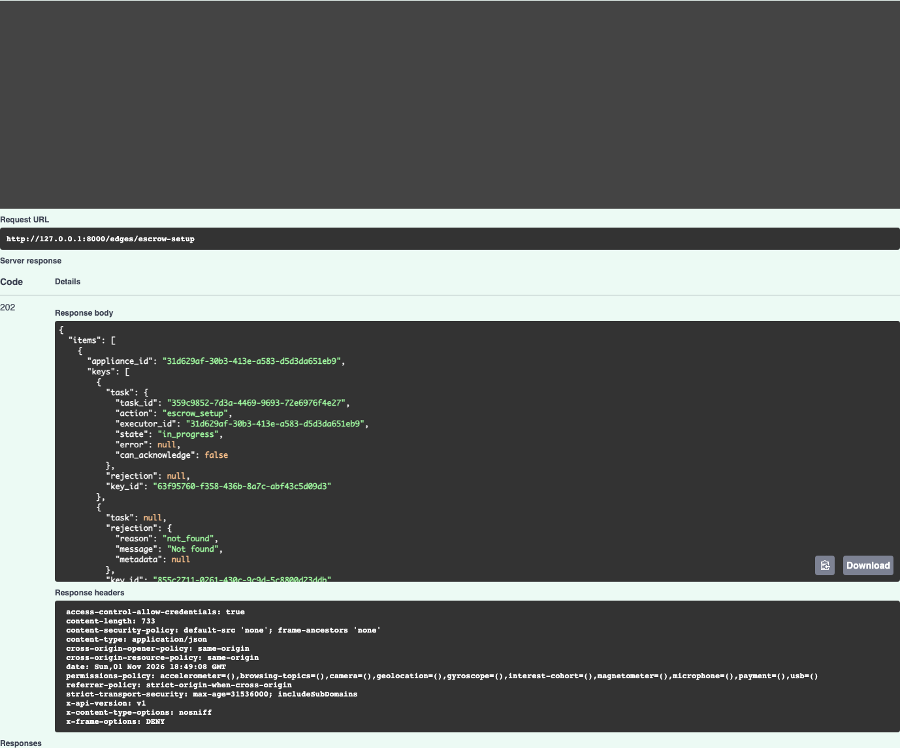
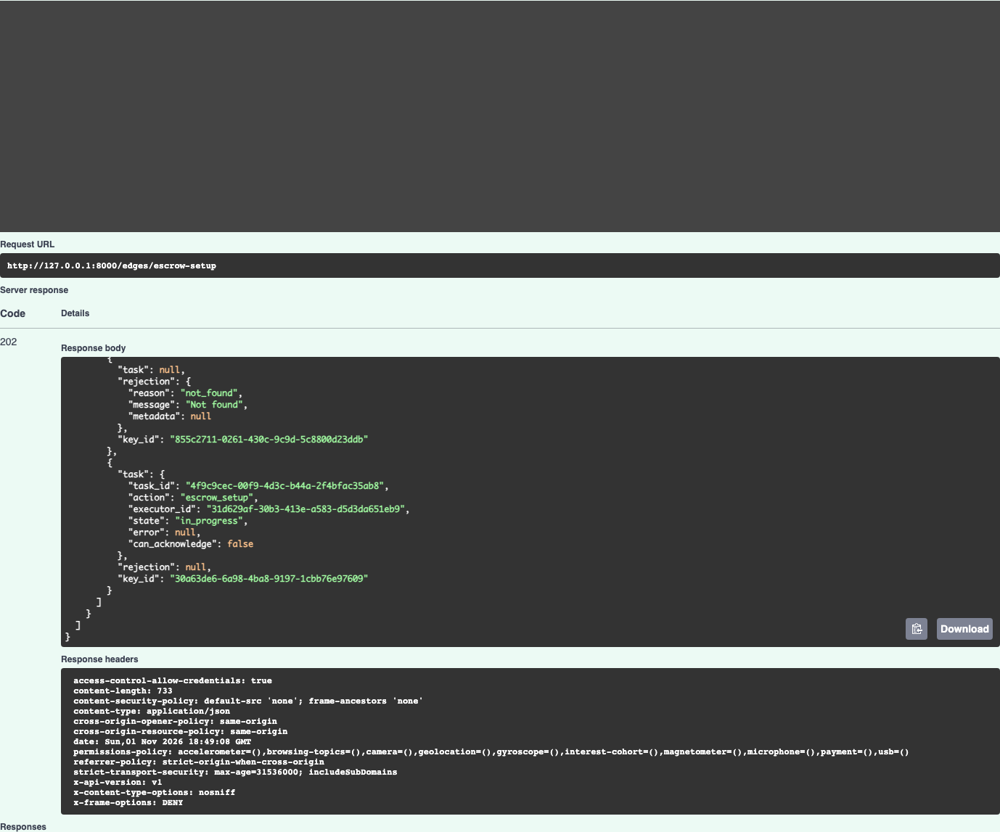
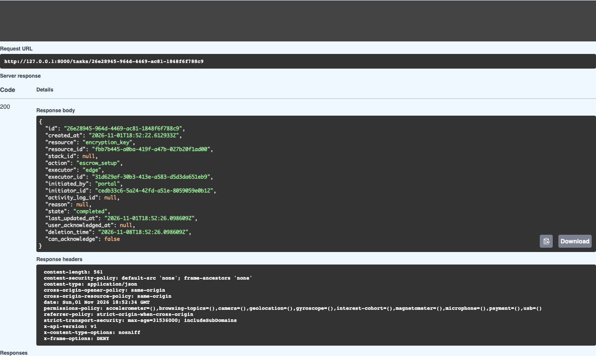
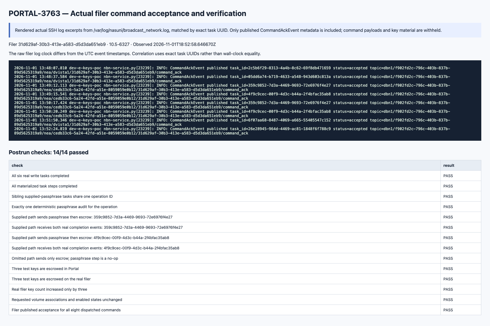

# PORTAL-3763 real-filer testing evidence

Tested application: [`dca34b220abb5acfe9ec3e41adbf67ef69b4a280`](https://github.com/nasuni/portal/commit/dca34b220abb5acfe9ec3e41adbf67ef69b4a280), branch `sbhushan/PORTAL-3763_escrow_setup`, [PR #3056](https://github.com/nasuni/portal/pull/3056). Run `20261101-182817`, 1 November 2026 UTC / 2 November IST.

**30 published native Swagger requests matched their expected HTTP status and the UI/network response. Six actual write tasks and all 15 materialized steps completed from real appliance events. Fourteen independent postrun checks passed.** This is live development-environment evidence with the controls below; it does not establish production rollout readiness or complete ACK ingestion.

## Target and outcomes

- Account `f902fd2c-796c-403b-837b-89d5625319a9` (`sbhushan1`), filer `31d629af-30b3-413e-a583-d5d3da651eb9`, actual build **10.5-6327**.
- Existing volume `0a1d5257-81d2-4bfd-ab67-06f6d9d12a3f_0`: associations and enabled states unchanged in both SSH metadata and API before/after captures.
- Three newly generated, protected RSA-3072 OpenPGP keys uploaded through the existing multipart API, with `escrow=false`, `backup_key=false`.
- Supplied-passphrase setup selected two uploaded keys plus an unknown key. The response preserved the two task handles and ordered `not_found` rejection. Both real tasks continued from `update_escrow_passphrase` to `escrow_encryption_key` and completed; sibling tasks share one operation ID and produced exactly one deterministic passphrase audit.
- The supplied passphrase was the **existing filer value**, encrypted to its actual public key. The value was not intentionally changed. Setting it also attempts escrow for the appliance keyring, so baseline escrow flags are not claimed unchanged.
- A third key was uploaded **after** supplied-passphrase setup completed, then tested with passphrase omitted. Its passphrase step completed as a no-op; exactly one outbound escrow command and no passphrase command were recorded.
- All three test keys are escrowed in Portal readback and actual filer metadata. Filer key count increased from **69 to 72**. The three unattached test keys are retained; no deletion or volume association mutation was performed.

| Task ID | Action | Final state | Created-to-terminal elapsed |
| --- | --- | --- | --- |
| `2c5b6f29-8313-4a4b-8c62-69f8db471659` | `upload_encryption_key` | completed | 14.4 s |
| `05dd6a74-b719-4633-a548-943d603c813a` | `upload_encryption_key` | completed | 7.3 s |
| `359c9852-7d3a-4469-9693-72e6976f4e27` | `escrow_setup` | completed | 69.4 s |
| `4f9c9cec-00f9-4d3c-b44a-2f4bfac35ab8` | `escrow_setup` | completed | 127.6 s |
| `6f07aa68-8487-4069-a665-55405547c152` | `upload_encryption_key` | completed | 11.0 s |
| `26e28945-964d-4469-ac81-1848f6f788c9` | `escrow_setup` | completed | 3.5 s |

## Authorization and request contracts

| Check | Result |
| --- | --- |
| Missing bearer token | 401 |
| Missing Manage Escrow Passphrase permission | 403 |
| Missing Escrow Keys permission | 403 |
| Feature disabled in local test cache | 403 |
| Key Escrow license disabled in local negative-test cache | 403 |
| Empty appliances / empty keys / unknown field / duplicate appliances / duplicate keys / non-encrypted passphrase | 422 |
| 26 total keys across two appliance objects | 422 |
| Exactly 25 total keys across two appliance objects | 202 with 25 `not_found` rejections; validation boundary only, no 25-command throughput claim |
| Already escrowed key / unknown appliance and key | 202 with per-key rejection and no task |

Successful flows used the **real NOC Key Escrow entitlement**, verified enabled. Only the explicit negative license test used a temporary local cached value, restored afterward. Permission tests used persisted local users/roles; JWTs were signed with the running local API configuration. External IdP login was not tested.

## Evidence and ACK observation

[All postrun assertions](postrun-assertions.json), [actual ORM snapshot](database-and-filer/orm-snapshot.json), [filer verification](database-and-filer/filer-key-verification.json), [sanitized request summary](database-and-filer/request-summary.json), and [scenario inventory](scenario-manifest.json).

The filer published **eight `status=accepted` ACK log lines**, matched by exact task UUID. The local database recorded `acked_at` for **3/8 outbound rows**, and none of the six terminal tasks had `status=acknowledged`. All six tasks completed from their actual success events. The setup ACK log topics contain the initiating user UUID where upload ACK topics contain `dvista1`; this is an observed routing difference, not a proven root-cause diagnosis. **ACK delivery/ingestion/reconciliation remains an unresolved observation in this POC run.** Do not treat device publication as proof of Portal ingestion. The filer's log clock also differs from UTC event timestamps; correlation uses exact task IDs.

The two database/filer PNGs are **clearly labeled renders of actual ORM/SSH output**, not pgAdmin screenshots or application UI. Swagger PNGs are captures of the served UI, and each `result.json` verifies displayed status, URL and body against the actual response. Curl/auth controls and request secret fields are masked. Request ciphertext, plaintext passphrases, tokens, private keys and runtime credentials are excluded.

## Temporary controls and restoration

1. Ran the requested `make run`. After refreshing an expired local CodeArtifact token, image builds succeeded; ordinary startup hit **EMFILE opening source bind mounts**. No Docker daemon reset, destructive cleanup or volume deletion was used.
2. Used temporary images containing the tested Git source instead of the failing source mounts. The API image's empty generated namespace placeholders were extended for imports. This runtime workaround was not committed to application code. Other frontend/BFF tiers were not part of the Swagger test.
3. The pre-existing local database reported migration head but lacked `edges_v2.fiq_disk`. Tests used a fresh isolated database `portal3763_e2e_20261101_182817`, migrated from current source. Initial local identity fixtures in the old `portal` database are retained; no schema/drop/truncate changes were made there.
4. Seeded local read projections from actual SSH-observed filer metadata; recorded readiness refreshes were tied to fresh SSH liveness. This did not test initial full-dump ingestion. A real combined EventHub worker consumed fresh account-filtered queues and processed actual events; no synthetic completion messages were injected.
5. **`include_in_schema=True` was added only for testing** the hidden setup route. It is restored to **`False`**, and restored-runtime `/openapi.json` no longer contains `/edges/escrow-setup`.
6. The user explicitly approved a temporary **10.6 → 10.5 minimum-version override**, because this POC filer reports 10.5-6327. Source and running runtime are restored to **10.6**. This run is not verification against a supported 10.6 appliance.
7. The local feature override was removed/restored to the original absent-cache state, and negative license/feature controls were restored. Application HEAD is unchanged and the user's existing Edge Console work is preserved. See [restoration verification](restoration-verification.json) and [cache restoration](cache-restoration.json).
8. Test databases/identity fixtures, source-copy containers/images, two dedicated SQS queues/four subscriptions, and private local generation material remain for inspection. Queue message retention is one day; that does not automatically remove the queues. No application-code commit or Copilot review was requested by this test run.

Fault-injected lookup, database, dispatch and next-step persistence errors remain covered by the automated suites described in the PR; they were not injected into the live filer. Cross-tenant ownership, unsupported-version rejection, external login, rollout and worst-case 25-key dispatch latency were not live-tested here.

## Captures and retained diagnostics

Six preliminary successful key-metadata reads are retained privately and excluded from this publication. Three fresh final readbacks use a neutral local fixture display name, `PORTAL-3763 Test Appliance`; the real filer was not renamed. Original screenshots were not edited or replaced with fabricated responses. There were 36 successful native requests in the complete private run, of which 30 are published here.

**91 PNGs**: 85 from the 30 passing Swagger requests, 2 labeled actual-result renders, and 4 from two retained harness setup failures. The initial volume 404 occurred before projections existed; the subsequent 500 was caused by the fixture's uppercase `RSA` value. The fixture was normalized to `rsa`, with no application-code change; the successful baseline and final volume reads are separate captures. Diagnostics are excluded from passing counts.

Open [index.html](index.html) locally for a screenshot gallery, or browse the linked files in [scenario-manifest.json](scenario-manifest.json). [png-sha256.json](png-sha256.json) records screenshot sizes and hashes.

### Selected native Swagger captures

