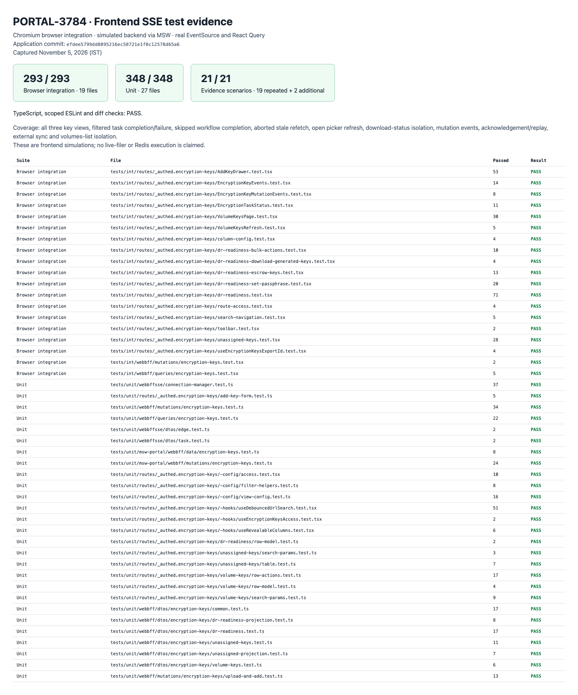

# PORTAL-3784 — Frontend SSE refresh evidence

Tested November 5, 2026 (IST), application commit `efdee5799dd8895216ec58721e1f8c12578d65a6` on `sbhushan/PORTAL-3784_sse_events_frontend`.

PR: https://github.com/nasuni/portal/pull/3079
Ticket: https://nasuni.atlassian.net/browse/PORTAL-3784

## Environment and scope

Chromium browser integration tests use MSW to simulate the backend HTTP responses and SSE stream. The frontend components, EventSource transport, SSE parsing/subscription, React Query invalidation, HTTP requests and rendered UI are real. These captures do not claim live-appliance execution or Redis delivery. Backend validation is recorded separately in [PORTAL-3545](../../PORTAL-3545/README.md) and [PR #3078](https://github.com/nasuni/portal/pull/3078).

Each UI screenshot includes a clearly labeled evidence footer. It records the latest event actually delivered to a frontend subscriber and the observed HTTP requests. The adjacent JSON file records the complete published/received event and request traces for that capture. The footer exists only in the ignored local capture harness; application source was not modified.

## Results

| Check | Result |
| --- | --- |
| Encryption-key browser integration suite | **293 passed**, 19 files |
| Encryption-key and SSE unit suite | **348 passed**, 27 files |
| Screenshot capture subset | **19 passed**, reruns of baseline scenarios |
| Supplemental external-sync and volume-isolation captures | **2 passed** |
| TypeScript (`pnpm exec tsc -b`) | Passed |
| Scoped ESLint | Passed |
| `git diff --check` | Passed |

The capture subset overlaps the main browser suite; it is not counted as 19 additional distinct product tests. The supplemental capture-only tests cover backup designation from an external sync and absence of volumes-list refresh on keyring events.



## Evidence matrix

| Flow | Before | After / observed result |
| --- | --- | --- |
| Volume Keys keyring signal | [Before](01-volume-keys-before.png) | [Updated view](01-volume-keys-after.png) |
| DR Readiness keyring signal | [Before](01-dr-readiness-before.png) | [Updated view and warning count](01-dr-readiness-after.png) |
| Unassigned Keys keyring signal | [Before](01-unassigned-before.png) | [Updated view](01-unassigned-after.png) |
| Open Select Existing picker | [Old choice](02-picker-before.png) | [New choice; picker reads 1→2, download reads remain 1](02-picker-after.png) |
| Final workflow completion without a key-data change | [Pending](03-task-pending.png) | [Completed, pending task removed, stale refetch aborted](03-task-completed.png) |
| Set passphrase | [Before](04-set-passphrase-before.png) | [Refreshed](04-set-passphrase-after.png) |
| Rotate existing passphrase | [Before](04-rotate-passphrase-before.png) | [Refreshed](04-rotate-passphrase-after.png) |
| Escrow key | [Before](04-escrow-before.png) | [Refreshed](04-escrow-after.png) |
| Set passphrase and escrow | [Before](04-set-passphrase-and-escrow-before.png) | [Refreshed](04-set-passphrase-and-escrow-after.png) |
| Enable / Disable volume key | [Before](05-volume-before.png) | [Enabled](05-volume-enabled.png), [Disabled](05-volume-disabled.png) |
| Add / Upload-and-Add | [Before](05-volume-before.png) | [Added existing key](05-volume-added.png), [Uploaded key appears](05-volume-uploaded.png) |
| Failed volume-key task acknowledgement | [Error present](06-ack-before.png) | [Error cleared; replay emits nothing](06-ack-after.png) |
| Delete success | [Pending](07-delete-success-pending.png) | [Key removed](07-delete-completed.png) |
| Delete failure and acknowledgement | [Pending](07-delete-failure-pending.png) | [Failure and acknowledge control](07-delete-failed.png), [Error cleared](07-delete-failure-acknowledged.png) |
| Backup designation from simulated appliance sync | [Before](08-backup-sync-before.png) | [Backup designation updated without a Portal mutation](08-backup-sync-after.png) |
| Volumes-list isolation | [Before](09-volumes-before.png) | [Keyring event received; no extra volumes refetch](09-volumes-after.png) |

The mutation-event tests send HTTP requests directly, bypassing mutation-hook invalidation. Their successful UI/cache updates therefore exercise the SSE refresh path. The deletion failure/acknowledgement captures use the actual UI. Generic keyring captures deliberately change mock feed labels so the before/after refresh is visible; these labels are test fixtures.

## Checked behavior

- `edge.encryption_keyring_change` refreshes the Volume Keys, DR Readiness and Unassigned Keys lists.
- Encryption-key `task.completed` and `task.failed` events refresh pending/error state, filtered to the explicit mutation actions agreed during review.
- Completion can clear pending state even when no further key data changes.
- A superseded in-flight refetch is aborted; this is a client behavior, not a backend-load guarantee.
- Available-key queries belong to the lists prefix, so an already open Select Existing picker updates.
- Download-status and public-key queries stay outside event-driven list invalidation.
- Heartbeats, generic edge/volume events, acknowledgement events, unrelated task actions and read/download task actions do not trigger key-list invalidation.
- Rejected mutations, identical toggles and acknowledgement replay do not publish extra keyring-change events in the stateful mock contract.
- Acknowledging a failed task updates the row in place.
- A keyring event does not refresh the volumes list.

## Review decisions and limits

The current implementation intentionally follows the subsequent PR decisions to handle filtered encryption-key task completion/failure in addition to keyring changes. The ticket description's earlier two-trigger/no-action-matching wording does not yet reflect those decisions.

SSE remains best-effort: recovery of missed events after stream reconnection is unchanged. Independent appliance reachability/build/sync freshness is tracked in PORTAL-2977. Periodic appliance-sync delivery and actual appliance command execution belong to the backend evidence; the external-sync capture here simulates that resulting event.

The baseline browser run emitted ResizeObserver-loop messages during some acknowledgement-layout tests; all 293 tests passed with zero failed cases. No warnings were suppressed for the evidence run.

## Reproduction and artifacts

- [Browser results JSON](browser-results.json) and [log](browser-tests.log)
- [Unit results JSON](unit-results.json) and [log](unit-tests.log)
- [Capture results JSON](capture-results.json) and [log](capture-tests.log)
- [Supplemental results JSON](additional-results.json) and [log](additional-tests.log)
- [Metadata, tested revision and screenshot hashes](run-metadata.json)
- [HTML summary](test-summary.html) and [full image gallery](gallery.html)
- [Capture harness](capture-scripts/config.ts), [recorder](capture-scripts/capture-support.ts), [supplemental tests](capture-scripts/external.capture.test.tsx)

Commands were run from `frontend/`:

```sh
pnpm exec vitest run --project=int --browser.headless=true tests/int/routes/_authed.encryption-keys tests/int/webbff/queries/encryption-keys.test.tsx tests/int/webbff/mutations/encryption-keys.test.tsx --maxWorkers=2
pnpm exec vitest run --project=unit tests/unit/routes/_authed.encryption-keys tests/unit/webbff/dtos/encryption-keys tests/unit/webbff/queries/encryption-keys.test.ts tests/unit/webbff/mutations/encryption-keys tests/unit/msw-portal/webbff/data/encryption-keys.test.ts tests/unit/msw-portal/webbff/mutations/encryption-keys.test.ts tests/unit/webbffsse
pnpm exec tsc -b
```

For capture reproduction, copy `capture-scripts/` into `frontend/.local/portal-3784-evidence/`, update `evidenceDir` in the config, and run Vitest with `--config .local/portal-3784-evidence/config.ts`. The config instruments existing tests in memory; tracked source files are unchanged.

An earlier capture-only attempt failed because the telemetry spy polluted the cancellation test's fetch-spy history. The recorder was changed to preserve the original spy semantics, and the full capture subset then passed. [The failed attempt](attempt1-capture-results.json) and [its log](attempt1-capture-tests.log) are retained for transparency; the uninstrumented baseline suite passed throughout.

