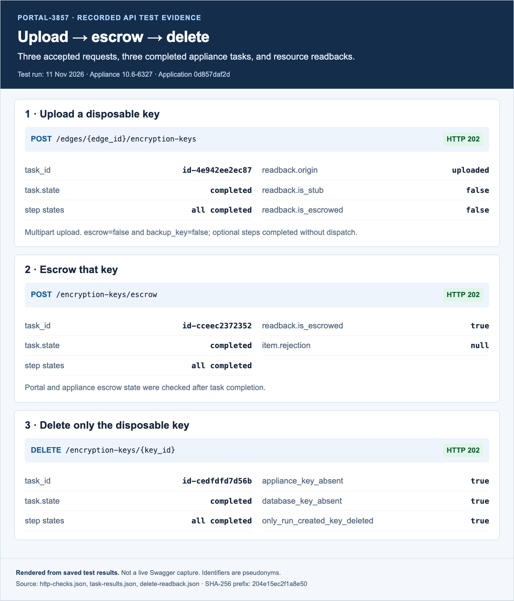
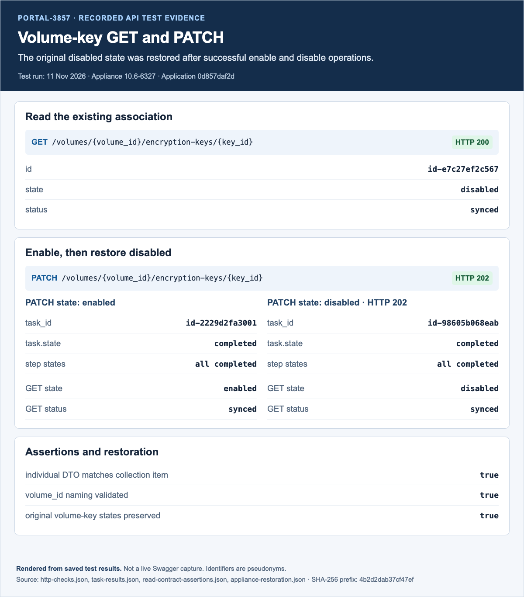
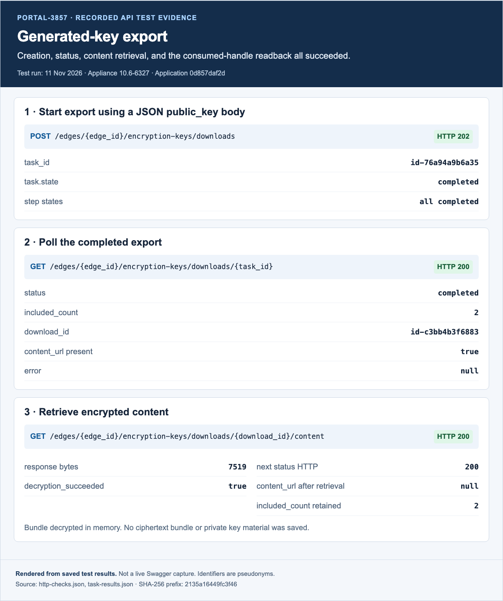
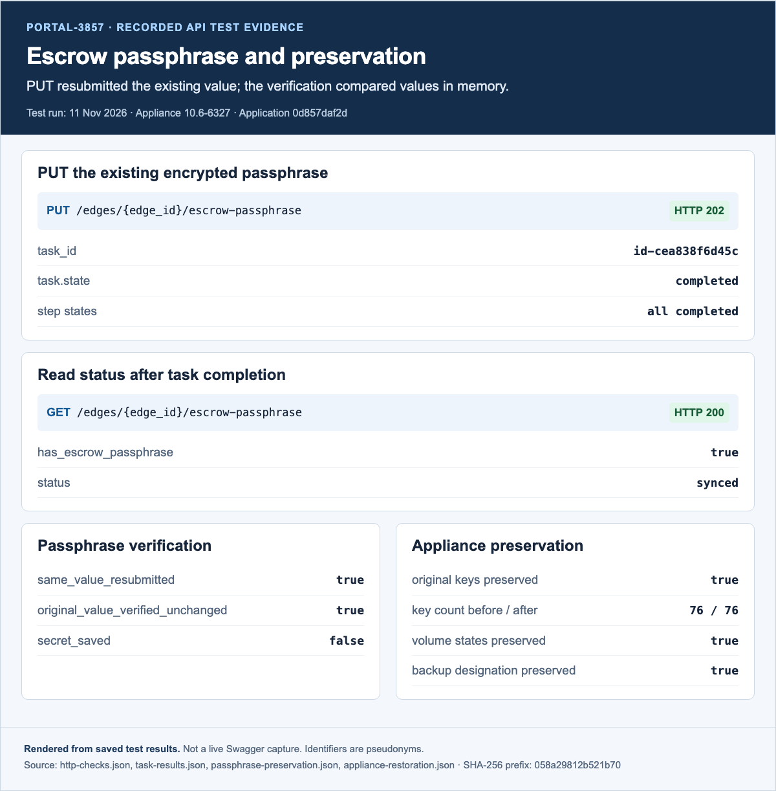
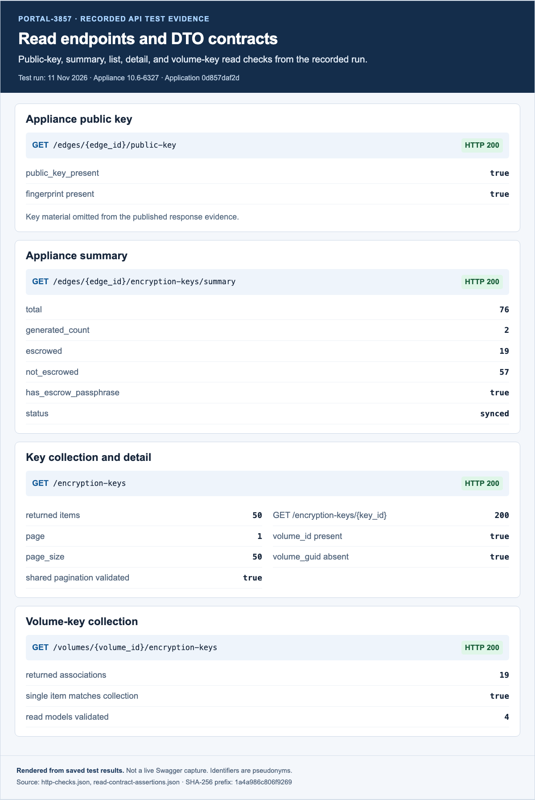

# PORTAL-3857 — encryption-key API testing

**16/16 happy-path scenarios passed; seven real-appliance tasks completed. Both migration tests passed.**

Tested source: [`nasuni/portal@0d857daf2d`](https://github.com/nasuni/portal/commit/0d857daf2df3fc2dfbf214e0944a2eb72d003ebd). Based on MVI-3 at `de14b6fc96f227f59bd984beb8b704a53a525c14`. The run occurred on 11 November 2026 against appliance version `10.6-6327`.

## Endpoint results

| Scenario | Request | Result |
|---|---|---|
| upload | `POST /edges/{edge_id}/encryption-keys` | PASS (202) |
| passphrase_set | `PUT /edges/{edge_id}/escrow-passphrase` | PASS (202) |
| public_key | `GET /edges/{edge_id}/public-key` | PASS (200) |
| summary | `GET /edges/{edge_id}/encryption-keys/summary` | PASS (200) |
| passphrase_status | `GET /edges/{edge_id}/escrow-passphrase` | PASS (200) |
| export_start | `POST /edges/{edge_id}/encryption-keys/downloads` | PASS (202) |
| export_status | `GET /edges/{edge_id}/encryption-keys/downloads/{task_id}` | PASS (200) |
| export_content | `GET /edges/{edge_id}/encryption-keys/downloads/{download_id}/content` | PASS (200) |
| escrow | `POST /encryption-keys/escrow` | PASS (202) |
| delete | `DELETE /encryption-keys/{key_id}` | PASS (202) |
| volume_key | `GET /volumes/{volume_id}/encryption-keys/{key_id}` | PASS (200) |
| enable | `PATCH /volumes/{volume_id}/encryption-keys/{key_id}` | PASS (202) |
| disable | `PATCH /volumes/{volume_id}/encryption-keys/{key_id}` | PASS (202) |
| key_list | `GET /encryption-keys` | PASS (200) |
| key_detail | `GET /encryption-keys/{key_id}` | PASS (200) |
| volume_key_list | `GET /volumes/{volume_id}/encryption-keys` | PASS (200) |

## Evidence

- [29 HTTP checks](http-checks.json): sanitized responses and readbacks. List inventories are represented by counts and field names.
- [Seven completed tasks](task-results.json): each task and all its steps completed; HTTP 202 alone was not counted as completion.
- [Read contract assertions](read-contract-assertions.json): shared pagination, `volume_id`, and item/list DTO consistency.
- [Appliance preservation](appliance-restoration.json): all original 76 keys, volume key states and backup designation preserved.
- [Passphrase preservation](passphrase-preservation.json): PUT resubmitted the existing value and verified it unchanged.
- [Disposable key deletion](delete-readback.json): uploaded test key absent from both Portal and appliance inventory after DELETE.
- [Migration preflight](migration-preflight.json): 65 revisions, one linear head, local database already at that head; fresh-database upgrade and single-head tests passed.
- [Automated tests](automated-test-results.json): separate suite results and original log hashes.
- [Commit checks](commit-checks.json): all applicable pre-commit hooks passed without bypassing them.
- [Provenance](provenance.json): application revision, tree and source artifact hashes.

## Evidence images

These images render the saved, sanitized API responses and task/readback results. They are not live Swagger screenshots. Source hashes and image hashes are recorded in [image provenance](images/provenance.json).

### Upload, escrow and deletion

### Volume-key GET and PATCH

### Generated-key export

### Escrow passphrase and preservation

### Read endpoint contracts

## Execution and limits

Requests used the temporary WebAPI from the feature worktree, a persisted local test user/role, and real appliance commands/replies through the existing developer SQS queues. Final write verification included task/step completion and database/appliance readbacks. Generated-key export retrieval was decrypted in memory; no bundle or private key material was saved.

Only happy paths were requested for this real-appliance run. Feature flags and the escrow license were controlled through local caches, and readiness was refreshed from SSH observations; this does not verify production entitlement or heartbeat ingestion. Existing unit/integration suites cover additional contracts but overlap, so their counts are not summed.

The old response harness initially supplied no Lambda context, causing response retries. Switching to the repository’s standard local poller resolved that harness mismatch without changing application code or reissuing the upload. Two temporary test queues and four subscriptions initially created for this run were removed and verified absent when the user requested existing queues. The local runtime and fixtures were retained at the user’s request after testing.

The inherited migration-ordering difference between MVI-3 and newer main belongs to the separate migration ticket; this endpoint PR adds no migrations.

## Publication scope

This is a sanitized evidence copy. Identifiers are consistent pseudonyms, resource names are masked, and full inventories, credentials, passphrases, key material, runtime scripts/configuration and raw process logs are excluded. These are HTTP/API results, not screenshots from the historical Swagger run.

## CI follow-up

The first CI run exposed seven parameterized upload tests that still expected `BadRequest` instead of the new `ResourceConflict`/409 contract. Commit `92617b8ae8938e052a10e4271fc95af7c4766c8b` updates those assertions only. The full encryption-key integration suite now passes: **224 passed, 7 warnings in 21.55s**. Production code is unchanged, so the real-appliance evidence above remains tied to its original tested commit. See [command, result, and log hash](ci-followup.json).
