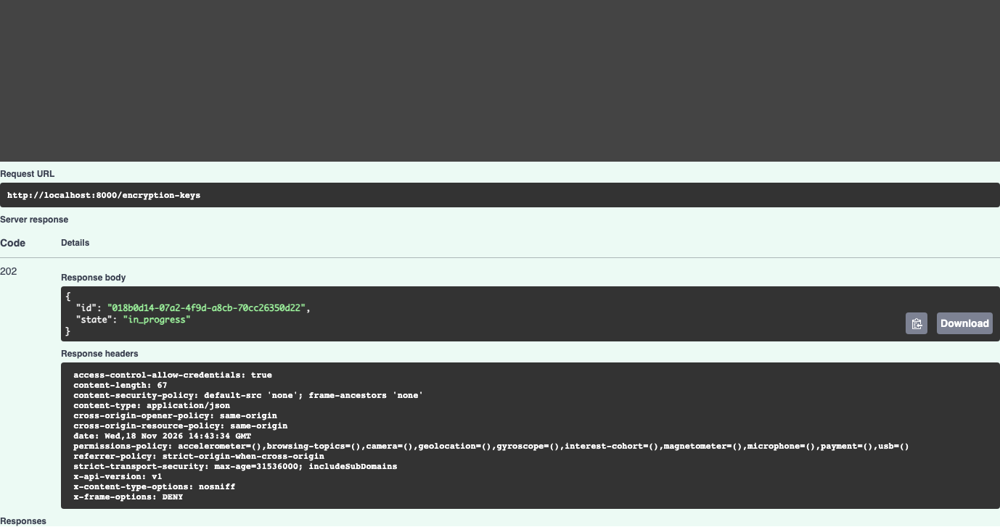
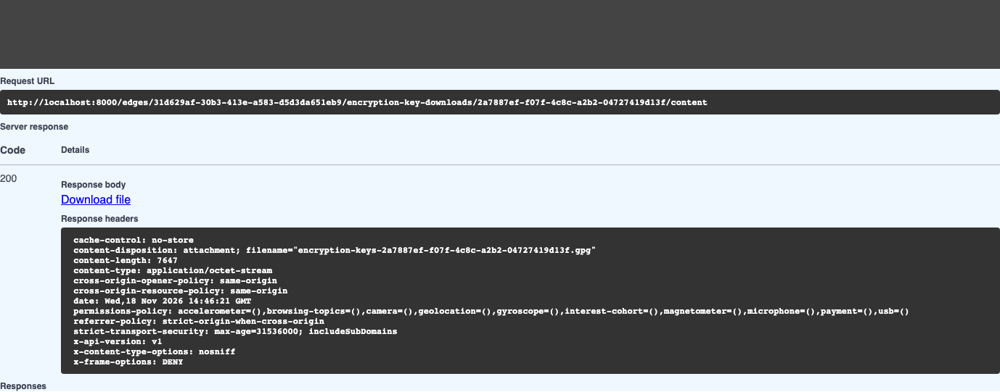
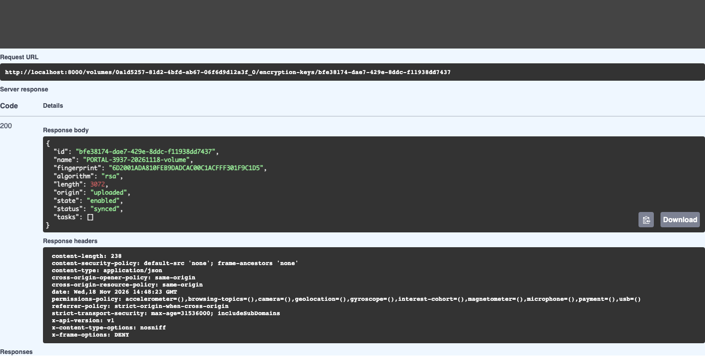
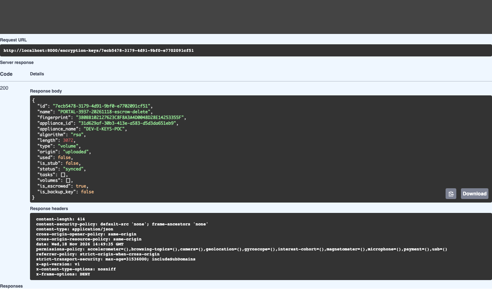

# PORTAL-3937 — encryption-key API happy-path evidence

Tested 2026-11-18 against commit `ce4ad5840a33705c69e031bc9df65946b1eaa4f1` after `make run` rebuilt the local stack. Both database migration containers exited successfully.

**PASS:** 16 encryption-key HTTP operations, 38 Swagger requests, and 10 completed appliance tasks. Screenshots show the native served Swagger UI; displayed responses were checked against browser network responses.

## Environment and scope

- Appliance: `DEV-E-KEYS-POC`; volume: `E-Keys-Test-01`.
- API: `http://localhost:8000`; authenticated using a locally minted test session.
- Used the approved temporary local readiness and feature-cache setup. SSH verified appliance liveness before readiness refreshes. Original controls were restored afterward, preserving any newer external updates.
- These checks cover API requests, actual appliance processing, terminal task results, and resource readback. They do not validate production login, deployment, or heartbeat freshness.
- Generated test keys using `devtools/edge-console/app/keygen.py`. Existing escrow passphrase was reapplied and verified unchanged.

This run covers each endpoint’s happy path. Optional upload chaining/backup-key selection, failure handling, retries, and timeout scenarios were not exercised.

## Operation coverage

| Method | Route | Result | Swagger evidence |
| --- | --- | --- | --- |
| POST | `/edges/{edge_id}/encryption-key-downloads` | PASS | [15_export_console_request](15_export_console_request/result.json) |
| GET | `/edges/{edge_id}/encryption-key-downloads/{task_id}` | PASS | [16_export_console_status](16_export_console_status/result.json), [18_export_console_after](18_export_console_after/result.json) |
| GET | `/edges/{edge_id}/encryption-key-downloads/{task_id}/content` | PASS | [17_export_console_content](17_export_console_content/result.json) |
| GET | `/edges/{edge_id}/encryption-key-summary` | PASS | [02_summary](02_summary/result.json) |
| GET | `/edges/{edge_id}/escrow-passphrase` | PASS | [04_passphrase](04_passphrase/result.json), [36_passphrase_readback](36_passphrase_readback/result.json) |
| PUT | `/edges/{edge_id}/escrow-passphrase` | PASS | [34_put_passphrase](34_put_passphrase/result.json) |
| GET | `/edges/{edge_id}/public-key` | PASS | [03_public_key](03_public_key/result.json) |
| GET | `/encryption-keys` | PASS | [01_list](01_list/result.json) |
| POST | `/encryption-keys` | PASS | [06_upload_escrow-delete](06_upload_escrow-delete/result.json), [06_upload_volume](06_upload_volume/result.json) |
| DELETE | `/encryption-keys/{key_id}` | PASS | [40_delete](40_delete/result.json) |
| GET | `/encryption-keys/{key_id}` | PASS | [08_get_escrow-delete](08_get_escrow-delete/result.json), [08_get_volume](08_get_volume/result.json), [39_escrow_readback](39_escrow_readback/result.json), [42_deleted_key_readback](42_deleted_key_readback/result.json) |
| POST | `/encryption-keys/{key_id}/escrow` | PASS | [37_escrow](37_escrow/result.json) |
| GET | `/volumes/{volume_id}/encryption-keys` | PASS | [05_volume_keys](05_volume_keys/result.json), [23_volume_list](23_volume_list/result.json) |
| POST | `/volumes/{volume_id}/encryption-keys` | PASS | [20_volume_add](20_volume_add/result.json) |
| GET | `/volumes/{volume_id}/encryption-keys/{key_id}` | PASS | [22_volume_key_after_add](22_volume_key_after_add/result.json), [26_volume_key_disabled](26_volume_key_disabled/result.json), [29_volume_key_enabled](29_volume_key_enabled/result.json), [32_volume_key_disabled](32_volume_key_disabled/result.json) |
| PATCH | `/volumes/{volume_id}/encryption-keys/{key_id}` | PASS | [24_volume_disabled](24_volume_disabled/result.json), [27_volume_enabled](27_volume_enabled/result.json), [30_volume_disabled](30_volume_disabled/result.json) |

## State verification

- Every accepted command reached `completed`; task GET responses and database terminal states were checked.
- Export: decrypted the downloaded bundle, verified both generated-key fingerprints against the appliance, and confirmed `available=true` before retrieval and `available=false` afterward.
- Volume key: added, disabled, enabled, then disabled again; API and appliance state agree.
- Escrow/delete: escrow state became true, the disposable key was deleted, and its GET returned the expected 404.
- All original key metadata and volume associations were preserved. The one new volume test key remains associated but disabled because there is no unassociate endpoint.
- Retained fixture: key `bfe38174-dae7-429e-8ddc-f11938dd7437`, fingerprint `6D2001ADA810FEB9DADCAC00C1ACFFF301F9C1D5`.

Verification: [export](export-console-verification.json), [passphrase](passphrase-verification.json), [volume](volume-flow.json), [escrow/delete](escrow-delete-verification.json), [final appliance comparison](final-resource-verification.json), [control restoration](control-restoration.json).

## Screenshots

### 06_upload_volume

### 17_export_console_content

### 29_volume_key_enabled

### 39_escrow_readback

## All captures

| Scenario | HTTP | Result | Screenshots |
| --- | --- | --- | --- |
| [01_list](01_list/result.json) | 200 | PASS | [1](01_list/01_list_parameters_01.png), [2](01_list/01_list_parameters_02.png), [3](01_list/01_list_response_01.png), [4](01_list/01_list_response_02.png), [5](01_list/01_list_response_03.png) |
| [02_summary](02_summary/result.json) | 200 | PASS | [1](02_summary/02_summary_parameters_01.png), [2](02_summary/02_summary_response.png) |
| [03_public_key](03_public_key/result.json) | 200 | PASS | [1](03_public_key/03_public_key_parameters_01.png), [2](03_public_key/03_public_key_response.png) |
| [04_passphrase](04_passphrase/result.json) | 200 | PASS | [1](04_passphrase/04_passphrase_parameters_01.png), [2](04_passphrase/04_passphrase_response.png) |
| [05_volume_keys](05_volume_keys/result.json) | 200 | PASS | [1](05_volume_keys/05_volume_keys_parameters_01.png), [2](05_volume_keys/05_volume_keys_response_01.png), [3](05_volume_keys/05_volume_keys_response_02.png), [4](05_volume_keys/05_volume_keys_response_03.png), [5](05_volume_keys/05_volume_keys_response_04.png), [6](05_volume_keys/05_volume_keys_response_05.png), [7](05_volume_keys/05_volume_keys_response_06.png), [8](05_volume_keys/05_volume_keys_response_07.png), [9](05_volume_keys/05_volume_keys_response_08.png), [10](05_volume_keys/05_volume_keys_response_09.png), [11](05_volume_keys/05_volume_keys_response_10.png) |
| [06_upload_escrow-delete](06_upload_escrow-delete/result.json) | 202 | PASS | [1](06_upload_escrow-delete/06_upload_escrow-delete_parameters_01.png), [2](06_upload_escrow-delete/06_upload_escrow-delete_response.png) |
| [06_upload_volume](06_upload_volume/result.json) | 202 | PASS | [1](06_upload_volume/06_upload_volume_parameters_01.png), [2](06_upload_volume/06_upload_volume_response.png) |
| [07_upload_escrow-delete_task](07_upload_escrow-delete_task/result.json) | 200 | PASS | [1](07_upload_escrow-delete_task/07_upload_escrow-delete_task_parameters_01.png), [2](07_upload_escrow-delete_task/07_upload_escrow-delete_task_response.png) |
| [07_upload_volume_task](07_upload_volume_task/result.json) | 200 | PASS | [1](07_upload_volume_task/07_upload_volume_task_parameters_01.png), [2](07_upload_volume_task/07_upload_volume_task_response.png) |
| [08_get_escrow-delete](08_get_escrow-delete/result.json) | 200 | PASS | [1](08_get_escrow-delete/08_get_escrow-delete_parameters_01.png), [2](08_get_escrow-delete/08_get_escrow-delete_response.png) |
| [08_get_volume](08_get_volume/result.json) | 200 | PASS | [1](08_get_volume/08_get_volume_parameters_01.png), [2](08_get_volume/08_get_volume_response.png) |
| [15_export_console_request](15_export_console_request/result.json) | 202 | PASS | [1](15_export_console_request/15_export_console_request_parameters_01.png), [2](15_export_console_request/15_export_console_request_response.png) |
| [16_export_console_status](16_export_console_status/result.json) | 200 | PASS | [1](16_export_console_status/16_export_console_status_parameters_01.png), [2](16_export_console_status/16_export_console_status_response.png) |
| [17_export_console_content](17_export_console_content/result.json) | 200 | PASS | [1](17_export_console_content/17_export_console_content_parameters_01.png), [2](17_export_console_content/17_export_console_content_response.png) |
| [18_export_console_after](18_export_console_after/result.json) | 200 | PASS | [1](18_export_console_after/18_export_console_after_parameters_01.png), [2](18_export_console_after/18_export_console_after_response.png) |
| [19_export_console_task](19_export_console_task/result.json) | 200 | PASS | [1](19_export_console_task/19_export_console_task_parameters_01.png), [2](19_export_console_task/19_export_console_task_response.png) |
| [20_volume_add](20_volume_add/result.json) | 202 | PASS | [1](20_volume_add/20_volume_add_parameters_01.png), [2](20_volume_add/20_volume_add_response.png) |
| [21_volume_add_task](21_volume_add_task/result.json) | 200 | PASS | [1](21_volume_add_task/21_volume_add_task_parameters_01.png), [2](21_volume_add_task/21_volume_add_task_response.png) |
| [22_volume_key_after_add](22_volume_key_after_add/result.json) | 200 | PASS | [1](22_volume_key_after_add/22_volume_key_after_add_parameters_01.png), [2](22_volume_key_after_add/22_volume_key_after_add_response.png) |
| [23_volume_list](23_volume_list/result.json) | 200 | PASS | [1](23_volume_list/23_volume_list_parameters_01.png), [2](23_volume_list/23_volume_list_response_01.png), [3](23_volume_list/23_volume_list_response_02.png), [4](23_volume_list/23_volume_list_response_03.png), [5](23_volume_list/23_volume_list_response_04.png), [6](23_volume_list/23_volume_list_response_05.png), [7](23_volume_list/23_volume_list_response_06.png), [8](23_volume_list/23_volume_list_response_07.png), [9](23_volume_list/23_volume_list_response_08.png), [10](23_volume_list/23_volume_list_response_09.png), [11](23_volume_list/23_volume_list_response_10.png) |
| [24_volume_disabled](24_volume_disabled/result.json) | 202 | PASS | [1](24_volume_disabled/24_volume_disabled_parameters_01.png), [2](24_volume_disabled/24_volume_disabled_response.png) |
| [25_volume_task](25_volume_task/result.json) | 200 | PASS | [1](25_volume_task/25_volume_task_parameters_01.png), [2](25_volume_task/25_volume_task_response.png) |
| [26_volume_key_disabled](26_volume_key_disabled/result.json) | 200 | PASS | [1](26_volume_key_disabled/26_volume_key_disabled_parameters_01.png), [2](26_volume_key_disabled/26_volume_key_disabled_response.png) |
| [27_volume_enabled](27_volume_enabled/result.json) | 202 | PASS | [1](27_volume_enabled/27_volume_enabled_parameters_01.png), [2](27_volume_enabled/27_volume_enabled_response.png) |
| [28_volume_task](28_volume_task/result.json) | 200 | PASS | [1](28_volume_task/28_volume_task_parameters_01.png), [2](28_volume_task/28_volume_task_response.png) |
| [29_volume_key_enabled](29_volume_key_enabled/result.json) | 200 | PASS | [1](29_volume_key_enabled/29_volume_key_enabled_parameters_01.png), [2](29_volume_key_enabled/29_volume_key_enabled_response.png) |
| [30_volume_disabled](30_volume_disabled/result.json) | 202 | PASS | [1](30_volume_disabled/30_volume_disabled_parameters_01.png), [2](30_volume_disabled/30_volume_disabled_response.png) |
| [31_volume_task](31_volume_task/result.json) | 200 | PASS | [1](31_volume_task/31_volume_task_parameters_01.png), [2](31_volume_task/31_volume_task_response.png) |
| [32_volume_key_disabled](32_volume_key_disabled/result.json) | 200 | PASS | [1](32_volume_key_disabled/32_volume_key_disabled_parameters_01.png), [2](32_volume_key_disabled/32_volume_key_disabled_response.png) |
| [34_put_passphrase](34_put_passphrase/result.json) | 202 | PASS | [1](34_put_passphrase/34_put_passphrase_parameters_01.png), [2](34_put_passphrase/34_put_passphrase_response.png) |
| [35_passphrase_task](35_passphrase_task/result.json) | 200 | PASS | [1](35_passphrase_task/35_passphrase_task_parameters_01.png), [2](35_passphrase_task/35_passphrase_task_response.png) |
| [36_passphrase_readback](36_passphrase_readback/result.json) | 200 | PASS | [1](36_passphrase_readback/36_passphrase_readback_parameters_01.png), [2](36_passphrase_readback/36_passphrase_readback_response.png) |
| [37_escrow](37_escrow/result.json) | 202 | PASS | [1](37_escrow/37_escrow_parameters_01.png), [2](37_escrow/37_escrow_response.png) |
| [38_escrow_task](38_escrow_task/result.json) | 200 | PASS | [1](38_escrow_task/38_escrow_task_parameters_01.png), [2](38_escrow_task/38_escrow_task_response.png) |
| [39_escrow_readback](39_escrow_readback/result.json) | 200 | PASS | [1](39_escrow_readback/39_escrow_readback_parameters_01.png), [2](39_escrow_readback/39_escrow_readback_response.png) |
| [40_delete](40_delete/result.json) | 202 | PASS | [1](40_delete/40_delete_parameters_01.png), [2](40_delete/40_delete_response.png) |
| [41_delete_task](41_delete_task/result.json) | 200 | PASS | [1](41_delete_task/41_delete_task_parameters_01.png), [2](41_delete_task/41_delete_task_response.png) |
| [42_deleted_key_readback](42_deleted_key_readback/result.json) | 404 | PASS | [1](42_deleted_key_readback/42_deleted_key_readback_parameters_01.png), [2](42_deleted_key_readback/42_deleted_key_readback_response.png) |
